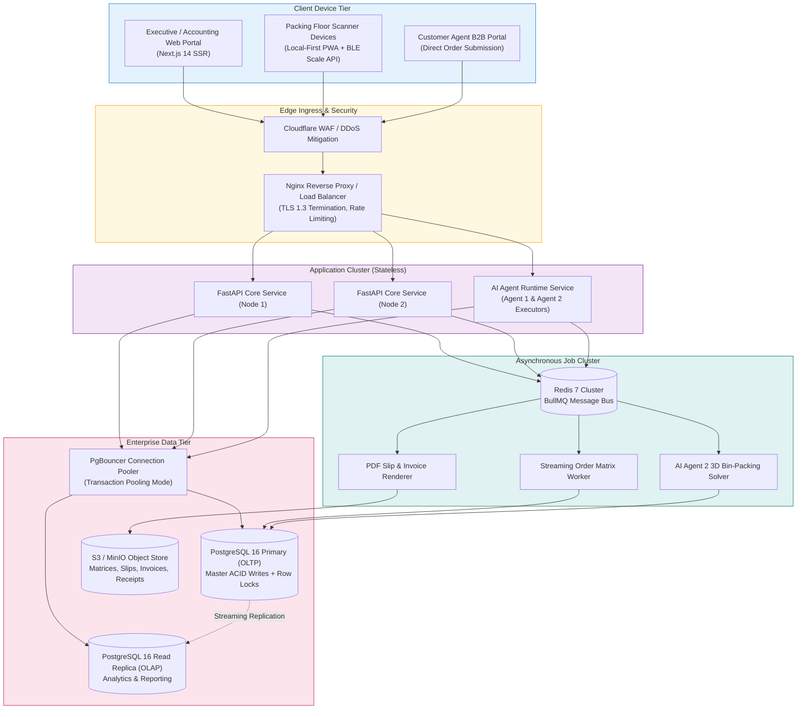
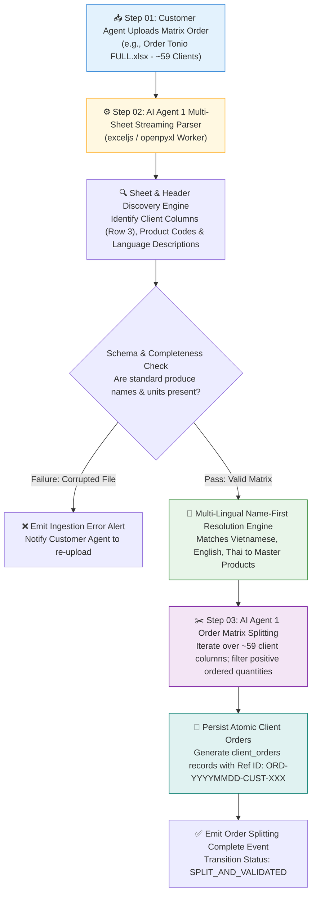
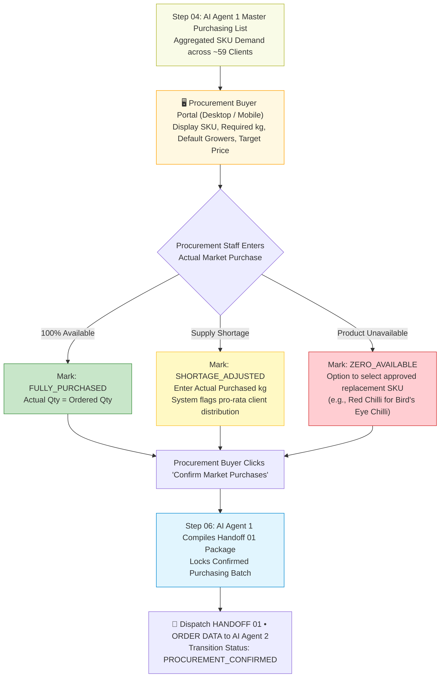
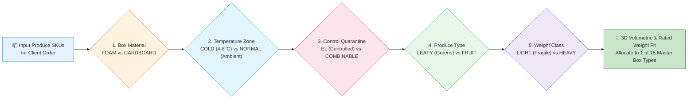
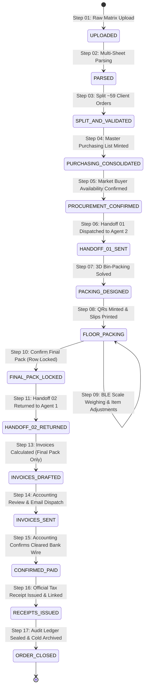
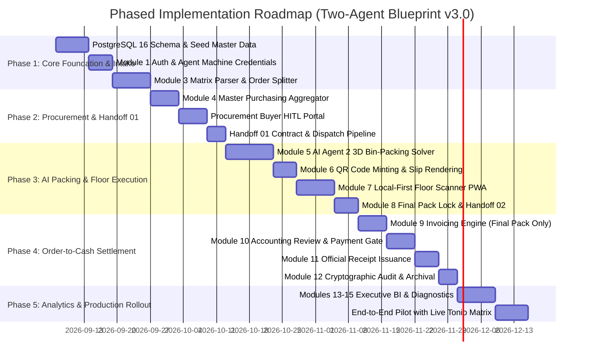

# Product Requirements Document (PRD)
# Fresh Produce AI Order-to-Cash Platform
## Two-Agent Operating Workflow (v3.0 Blueprint)

---

| Field | Detail |
|---|---|
| **Document Title** | Product Requirements Document (PRD) — Production Grade Enterprise Specification |
| **Enterprise Client** | Agriculture is Life Co., Ltd. (Thailand) |
| **Programme** | Autonomous Fresh Produce AI Order-to-Cash & Packing Intelligence Platform |
| **Architecture Blueprint** | HORIZONTAL SYSTEM BLUEPRINT / v3.0 (Two-Agent Operating Workflow) |
| **Source Documents** | BRD_Packing_Sales_Platform v0.1, Order Tonio FULL Matrix, Packing NGA/TETE Masters |
| **Version** | v3.0 (Enterprise Production Grade) |
| **Release Date** | September 2026 |
| **Classification** | Confidential — Internal Technical Architecture & Engineering Specification |

---

## Table of Contents

1. [Product Vision, Business Context & Success Metrics](#1-product-vision-business-context--success-metrics)
2. [The Two-Agent Horizontal Operating Architecture (Blueprint v3.0)](#2-the-two-agent-horizontal-operating-architecture-blueprint-v30)
   - 2.1 [Operating Architecture Topology](#21-operating-architecture-topology)
   - 2.2 [Agent 1 Profile: Commercial, Procurement & Financial Orchestrator](#22-agent-1-profile-commercial-procurement--financial-orchestrator)
   - 2.3 [Agent 2 Profile: Fulfillment & Box Optimization Orchestrator](#23-agent-2-profile-fulfillment--box-optimization-orchestrator)
   - 2.4 [Inter-Agent Communication Contracts (Handoff 01 & Handoff 02)](#24-inter-agent-communication-contracts-handoff-01--handoff-02)
   - 2.5 [The Golden Business Invariants](#25-the-golden-business-invariants)
3. [Technology Stack, Infrastructure & Edge Architecture](#3-technology-stack-infrastructure--edge-architecture)
4. [User Personas & Role-Based Access Control (RBAC) Matrix](#4-user-personas--role-based-access-control-rbac-matrix)
5. [Module 1 — Authentication, Multi-Tenancy & Agent Identity Management](#5-module-1--authentication-multi-tenancy--agent-identity-management)
6. [Module 2 — Master Data Management (Catalogue, Boxes, Routes, Prices)](#6-module-2--master-data-management-catalogue-boxes-routes-prices)
7. [Module 3 — Stage 01: Multi-Client Order Intake, Matrix Parsing & Splitting Engine](#7-module-3--stage-01-multi-client-order-intake-matrix-parsing--splitting-engine)
8. [Module 4 — Stage 01: Master Purchasing List Consolidation & Procurement Workflow](#8-module-4--stage-01-master-purchasing-list-consolidation--procurement-workflow)
9. [Module 5 — Stage 02: AI Agent 2 Autonomous Packing Design Engine](#9-module-5--stage-02-ai-agent-2-autonomous-packing-design-engine)
10. [Module 6 — Stage 02: Packing List & Box QR Code Generation](#10-module-6--stage-02-packing-list--box-qr-code-generation)
11. [Module 7 — Stage 02: Floor Execution, Digital Scale Integration & Item Adjustments](#11-module-7--stage-02-floor-execution-digital-scale-integration--item-adjustments)
12. [Module 8 — Stage 02: Final Pack Confirmation, Locking & Handoff 02](#12-module-8--stage-02-final-pack-confirmation-locking--handoff-02)
13. [Module 9 — Stage 03: Order-to-Cash Invoicing Engine](#13-module-9--stage-03-order-to-cash-invoicing-engine)
14. [Module 10 — Stage 03: Accounting Review, Dispatch & Payment Confirmation Gates](#14-module-10--stage-03-accounting-review-dispatch--payment-confirmation-gates)
15. [Module 11 — Stage 03: Official Receipt Issuance & Order Lifecycle Archival](#15-module-11--stage-03-official-receipt-issuance--order-lifecycle-archival)
16. [Module 12 — Audit Logging & Regulatory Compliance System](#16-module-12--audit-logging--regulatory-compliance-system)
17. [Module 13 — Executive Sales & Demand Dashboard](#17-module-13--executive-sales--demand-dashboard)
18. [Module 14 — Geography, Logistics & Route Analytics](#18-module-14--geography-logistics--route-analytics)
19. [Module 15 — Operational Diagnostics, Box Utilisation & Shrinkage Analytics](#19-module-15--operational-diagnostics-box-utilisation--shrinkage-analytics)
20. [Module 16 — Infrastructure Resilience, Backup & Disaster Recovery](#20-module-16--infrastructure-resilience-backup--disaster-recovery)
21. [Data Model — Complete PostgreSQL 16 Entity Relationship Schema](#21-data-model--complete-postgresql-16-entity-relationship-schema)
22. [API Design — Comprehensive Endpoint Map](#22-api-design--comprehensive-endpoint-map)
23. [Order Lifecycle State Machine & Concurrency Control](#23-order-lifecycle-state-machine--concurrency-control)
24. [Non-Functional Requirements & Enterprise SLAs](#24-non-functional-requirements--enterprise-slas)
25. [Phased Implementation Roadmap & Test Strategy](#25-phased-implementation-roadmap--test-strategy)
26. [Risk Register & Enterprise Mitigations](#26-risk-register--enterprise-mitigations)
27. [Glossary of Terms](#27-glossary-of-terms)

---

## 1. Product Vision, Business Context & Success Metrics

### 1.1 Business Context & Real-World Operations
Agriculture is Life Co., Ltd. operates a high-volume agricultural export business based in Thailand, shipping perishable Thai and Vietnamese fresh vegetables, culinary herbs, and tropical fruits to wholesale trade clients across Europe (e.g., France, Norway, Germany, Netherlands, UK).

Prior to this platform, operations operated on fragile, disconnected spreadsheets:
1. **Intake:** Weekly order matrices (e.g., `Order Tonio FULL.xlsx`) arrive via customer agents containing orders across ~59 distinct client accounts in multi-tab matrix spreadsheets.
2. **Purchasing:** Warehouse staff manually summed row totals by hand to compile wholesale market purchasing sheets early in the morning.
3. **Box Grouping:** Complex food-safety, temperature, and customs quarantine packing rules lived only in human heads, leading to compliance violations, box crushing, and poor volumetric container utilization.
4. **Traceability:** Once boxes left the packing facility, contents and exact scale weights were lost with zero scan-based traceability.
5. **Settlement:** Invoices were drafted before final packing was complete, causing frequent billing discrepancies when market produce shortages occurred. Receipts were unlinked, and financial audit logs were nonexistent.

### 1.2 Product Vision
Transform the manual operation into an autonomous, enterprise-grade, **Two-Agent AI Order-to-Cash Operating System**. The platform unifies the full commercial and physical fulfillment lifecycle into three interconnected stages governed by AI Agents and Human-in-the-Loop (HITL) checkpoints:
- **Stage 01 — Order Management & Procurement:** Multi-client matrix splitting, master purchasing consolidation, and procurement availability verification.
- **Stage 02 — Physical Packing & Fulfillment:** Autonomous 3D constraint-based bin-packing design, box QR generation, digital scale capture, floor item adjustments, and final pack locking.
- **Stage 03 — Order-to-Cash & Settlement:** Invoicing strictly derived from actual packed weights, accounting review/dispatch, cleared-funds confirmation, official tax receipt issuance, and cryptographic order archival.

### 1.3 Key Performance Indicators & Success Metrics

| Metric ID | Objective | Baseline (Manual) | Target SLA (v3.0 Platform) |
|---|---|---|---|
| **KPI-01** | Order-to-Purchasing Consolidation Time | 3 – 4 hours manual calculation | **< 30 seconds** (Automated matrix split & consolidation) |
| **KPI-02** | Packing Design Generation Speed | 2 – 3 hours manual spreadsheet layout | **< 45 seconds** (AI Agent 2 autonomous bin-packing) |
| **KPI-03** | Box Weight & Volumetric Utilisation | 68% average utilisation | **>= 88%** across all 15 master box types |
| **KPI-04** | Floor Scan & Digital Scale Capture Speed | 45 seconds per box (paper clipboards) | **< 4 seconds** per box via Bluetooth scale & QR scanner |
| **KPI-05** | Billing Weight Discrepancy Rate | 12.4% invoice dispute/rebill rate | **0.00%** (Mathematically locked to final scale weights) |
| **KPI-06** | End-to-End Traceability Query SLA | Several hours or impossible | **< 2 seconds** via unique Box UUID QR scan |
| **KPI-07** | Regulatory Grouping Compliance | Frequent border alerts (EL mixing) | **100.0%** algorithmic enforcement of quarantine rules |

---

## 2. The Two-Agent Horizontal Operating Architecture (Blueprint v3.0)

### 2.1 Operating Architecture Topology
The architecture implements a horizontal pipeline divided into three distinct operational domains governed by **AI Agent 1**, **AI Agent 2**, and three dedicated Human-in-the-Loop (HITL) checkpoints:

```mermaid
flowchart TD
    subgraph STAGE_01["Stage 01: ORDER MANAGEMENT (AI Agent 1)"]
        S01["01. Customer Agent: Submit Order File\n(1 file / multiple clients, ~59 orders)"]
        S02["02. AI Agent 1: Validate Data\n(Check format, headers & completeness)"]
        S03["03. AI Agent 1: Split Orders\n(Separate by client and reference ID)"]
        S04["04. AI Agent 1: Consolidate Items\n(Create one Master Purchasing List)"]
        S05["05. Procurement Staff (HITL):\nPurchase & Confirm Actual Available Items"]
        S06["06. AI Agent 1: Send to Agent 2\n(Send client-level orders & packing criteria)"]

        S01 --> S02 --> S03 --> S04 --> S05 --> S06
    end

    subgraph HANDOFF_1["HANDOFF 01 • ORDER DATA"]
        H1["Validated Client Orders + Confirmed Quantities + Packing Taxonomies"]
    end

    subgraph STAGE_02["Stage 02: PACKING (AI Agent 2)"]
        S07["07. AI Agent 2: Design Packing\n(Group items into boxes using 5-dim rules)"]
        S08["08. AI Agent 2: Packing List + QR\n(Create First Slip, Final Slip & QR for each box)"]
        S09["09. Packing Staff (HITL):\nFloor Scan, Weigh & Adjust Actual Items"]
        S10["10. AI Agent 2: Confirm Final Pack\n(Lock actual items, tare & gross weights)"]
        S11["11. AI Agent 2: Return Final Data\n(Return actual packed data to Agent 1)"]

        S07 --> S08 --> S09 --> S10 --> S11
    end

    subgraph HANDOFF_2["HANDOFF 02 • FINAL PACKING"]
        H2["Locked Box Records + Verified Scale Weights + Adjustment Log"]
    end

    subgraph STAGE_03["Stage 03: ORDER-TO-CASH (AI Agent 1)"]
        S12["12. AI Agent 1: Receive Final Pack\n(Review actual items & quantities per box)"]
        S13["13. AI Agent 1: Create Invoice\n(Calculate strictly from Final Packing only)"]
        S14["14. Accounting Staff (HITL):\nReview Invoice & Dispatch to Recipient"]
        S15["15. Accounting Staff (HITL):\nConfirm Payment Received in Bank"]
        S16["16. AI Agent 1: Issue Receipt\n(Create official tax receipt & link to invoice)"]
        S17["17. AI Agent 1: Close & Report\n(Archive status, seal audit ledger & push analytics)"]

        S12 --> S13 --> S14 --> S15 --> S16 --> S17
    end

    S06 --> H1 --> S07
    S11 --> H2 --> S12

    style STAGE_01 fill:#f9fbe7,stroke:#afb42b,stroke-width:2px
    style STAGE_02 fill:#e1f5fe,stroke:#0288d1,stroke-width:2px
    style STAGE_03 fill:#fce4ec,stroke:#c2185b,stroke-width:2px
    style HANDOFF_1 fill:#fff9c4,stroke:#fbc02d,stroke-width:2px
    style HANDOFF_2 fill:#e8f5e9,stroke:#388e3c,stroke-width:2px
```



### 2.2 Agent 1 Profile: Commercial, Procurement & Financial Orchestrator
- **Designation:** `ai-agent-commercial-finance`
- **Core Responsibilities:**
  1. Intake and parsing of complex matrix order spreadsheets (`Order Tonio FULL.xlsx`, ~59 client accounts across multiple tabs).
  2. Order splitting by customer, generating atomic client sub-orders with unique Reference IDs (`ORD-YYYYMMDD-CUST-XXX`).
  3. Master Purchasing List consolidation: Aggregates total demand by SKU for morning wholesale market buyers.
  4. Packaging and transmission of `HANDOFF 01 • ORDER DATA` to Agent 2.
  5. Receiving `HANDOFF 02 • FINAL PACKING` from Agent 2.
  6. Calculating draft invoices **strictly from locked Final Packing quantities and scale weights**.
  7. Interfacing with Human Accounting to track invoice dispatch and cleared payment status.
  8. Automatic generation and dispatch of Official Receipts cryptographically linked to invoices.
  9. Closing orders, locking database ledgers, and piping telemetry to Executive Analytics.
- **Safety Boundaries & Permitted Scopes:**
  - Full Read/Write on commercial, customer, pricing, and accounting ledgers.
  - Zero write permissions on physical packing floor manifests once locked.
  - Hard constraint: Cannot release Official Receipts without explicit Accounting cleared-funds sign-off.

### 2.3 Agent 2 Profile: Fulfillment & Box Optimization Orchestrator
- **Designation:** `ai-agent-packing-fulfillment`
- **Core Responsibilities:**
  1. Autonomous 3D Bin-Packing Optimization: Solves the multi-dimensional constraint packing problem using the 15 master box types.
  2. Strict enforcement of the 5 grouping dimensions (Foam vs Cardboard, Cold vs Normal, EL segregation, Leafy vs Fruit, Light vs Heavy, plus Norway route exception).
  3. Minting box-level UUIDs and rendering unique QR code graphics.
  4. Formatting and compiling First Slips (floor prep) and Final Named Slips (customs & transport).
  5. Interfacing with Floor Packing Staff via local-first PWA scanners and digital scale capture.
  6. Real-time reconciliation of physical floor adjustments (substitutions, shortages, pack size swaps).
  7. Executing the cryptographic "Confirm Final Pack" row lock.
  8. Compiling and transmitting `HANDOFF 02 • FINAL PACKING` back to Agent 1.
- **Safety Boundaries & Permitted Scopes:**
  - Full Read/Write on box records, item allocations, tare/gross weights, and physical QR codes.
  - Zero write permissions on product pricing, customer master contracts, or invoicing tables.

### 2.4 Inter-Agent Communication Contracts (Handoff 01 & Handoff 02)

#### 2.4.1 Handoff 01: Order Data Contract (Agent 1 -> Agent 2)
Triggered immediately after human Procurement staff confirms actual market inventory availability (Step 05).

```json
{
  "$schema": "https://json-schema.org/draft/2020-12/schema",
  "title": "Handoff_01_OrderData",
  "type": "object",
  "required": [
    "handoff_id",
    "timestamp",
    "shipment_date",
    "route_code",
    "procurement_batch_id",
    "confirmed_orders"
  ],
  "properties": {
    "handoff_id": { "type": "string", "format": "uuid" },
    "timestamp": { "type": "string", "format": "date-time" },
    "shipment_date": { "type": "string", "format": "date" },
    "route_code": { "type": "string", "enum": ["TETE", "NGA", "FR", "DE", "UK"] },
    "procurement_batch_id": { "type": "string", "format": "uuid" },
    "confirmed_orders": {
      "type": "array",
      "items": {
        "type": "object",
        "required": ["client_id", "client_name", "order_ref_id", "items"],
        "properties": {
          "client_id": { "type": "string", "format": "uuid" },
          "client_name": { "type": "string" },
          "order_ref_id": { "type": "string" },
          "destination_country": { "type": "string" },
          "items": {
            "type": "array",
            "items": {
              "type": "object",
              "required": [
                "product_id",
                "product_code",
                "product_name_en",
                "pack_size",
                "confirmed_pack_count",
                "box_material_req",
                "temperature_req",
                "control_status",
                "produce_type",
                "weight_class"
              ],
              "properties": {
                "product_id": { "type": "string", "format": "uuid" },
                "product_code": { "type": "string" },
                "product_name_en": { "type": "string" },
                "pack_size": { "type": "string" },
                "confirmed_pack_count": { "type": "integer", "minimum": 1 },
                "confirmed_net_weight_kg": { "type": "number", "minimum": 0.01 },
                "box_material_req": { "type": "string", "enum": ["FOAM", "CARDBOARD"] },
                "temperature_req": { "type": "string", "enum": ["COLD", "NORMAL"] },
                "control_status": { "type": "string", "enum": ["EL", "COMBINABLE"] },
                "produce_type": { "type": "string", "enum": ["LEAFY", "FRUIT", "HERB", "ROOT"] },
                "weight_class": { "type": "string", "enum": ["LIGHT", "HEAVY"] }
              }
            }
          }
        }
      }
    }
  }
}
```

#### 2.4.2 Handoff 02: Final Packing Contract (Agent 2 -> Agent 1)
Triggered immediately after packing floor staff locks the completed physical shipment (Step 10).

```json
{
  "$schema": "https://json-schema.org/draft/2020-12/schema",
  "title": "Handoff_02_FinalPacking",
  "type": "object",
  "required": [
    "handoff_id",
    "timestamp",
    "shipment_date",
    "route_code",
    "final_packing_manifest_id",
    "packed_by_staff_id",
    "locked_at",
    "boxes"
  ],
  "properties": {
    "handoff_id": { "type": "string", "format": "uuid" },
    "timestamp": { "type": "string", "format": "date-time" },
    "shipment_date": { "type": "string", "format": "date" },
    "route_code": { "type": "string" },
    "final_packing_manifest_id": { "type": "string", "format": "uuid" },
    "packed_by_staff_id": { "type": "string", "format": "uuid" },
    "locked_at": { "type": "string", "format": "date-time" },
    "total_boxes_count": { "type": "integer" },
    "total_shipment_net_weight_kg": { "type": "number" },
    "total_shipment_gross_weight_kg": { "type": "number" },
    "boxes": {
      "type": "array",
      "items": {
        "type": "object",
        "required": [
          "box_uuid",
          "box_number",
          "box_type_id",
          "client_id",
          "order_ref_id",
          "actual_gross_weight_kg",
          "actual_net_weight_kg",
          "rated_weight_kg",
          "qr_code_url",
          "items"
        ],
        "properties": {
          "box_uuid": { "type": "string", "format": "uuid" },
          "box_number": { "type": "integer" },
          "box_type_id": { "type": "string" },
          "client_id": { "type": "string", "format": "uuid" },
          "order_ref_id": { "type": "string" },
          "actual_gross_weight_kg": { "type": "number" },
          "actual_net_weight_kg": { "type": "number" },
          "rated_weight_kg": { "type": "number" },
          "qr_code_url": { "type": "string" },
          "items": {
            "type": "array",
            "items": {
              "type": "object",
              "required": [
                "product_id",
                "product_code",
                "pack_size",
                "final_pack_count",
                "final_net_weight_kg",
                "floor_adjustment_type"
              ],
              "properties": {
                "product_id": { "type": "string", "format": "uuid" },
                "product_code": { "type": "string" },
                "pack_size": { "type": "string" },
                "final_pack_count": { "type": "integer" },
                "final_net_weight_kg": { "type": "number" },
                "floor_adjustment_type": {
                  "type": "string",
                  "enum": ["AS_ORDERED", "SHORTAGE_REDUCED", "QUANTITY_INCREASED", "SUBSTITUTED"]
                }
              }
            }
          }
        }
      }
    }
  }
}
```

### 2.5 The Golden Business Invariants

> [!IMPORTANT]
> **INVARIANT 1: "Invoice Uses Final Packing Only"**  
> Customer invoices **must never** be generated from initial customer orders or morning procurement estimates. Due to wholesale market produce shortages, lot rejections, and weight adjustments made on warehouse scales, **the system strictly binds customer invoice line items, weights, and billing totals to the locked Final Packing dataset (`Handoff 02`)**. Any attempt to bill against pre-packing records will be rejected by the financial validation pipeline.

> [!IMPORTANT]
> **INVARIANT 2: "Issue Receipt Only After Accounting Confirms Payment"**  
> An Official Tax Receipt (`RCP-YYYYMMDD-XXXX`) is an immutable legal financial document. Invoices are dispatched to clients in state `INVOICE_SENT`. **AI Agent 1 is strictly blocked from generating and linking official receipts until a Human Accounting Officer explicitly inputs the bank reference and flags the order as `CONFIRMED_PAID`**.

---

## 3. Technology Stack, Infrastructure & Edge Architecture

### 3.1 Recommended Production-Grade Technology Stack

| Layer | Technology | Enterprise Justification |
|---|---|---|
| **Web Management Portal** | React 18 / Next.js 14 (App Router) | Server-Side Rendering (SSR) for high-performance dashboards, deep SEO/metadata isolation, rich data grids (TanStack Table v8). |
| **Packing Floor Scanner PWA** | Next.js Local-First PWA + Tailwind CSS + shadcn/ui | Offline-first scanning via IndexedDB, high-contrast industrial UI with large tactile touch targets, Web Bluetooth for digital scale sync. |
| **Backend API Services** | Python 3.12 (FastAPI) + Node.js 20 LTS | Async micro-services architecture; FastAPI delivers native Pydantic typing and high-speed data validation for Agent 1 and Agent 2. |
| **Agent Orchestration** | LangGraph / Autonomous Coordinator | State machine-driven deterministic agent execution with strict schema validation on tool calling and inter-agent handoffs. |
| **Database (Primary OLTP)** | PostgreSQL 16 + TimescaleDB extension | Robust ACID guarantees, JSONB support for dynamic produce attributes, Row-Level Security (RLS), continuous WAL archiving. |
| **Database (Read Replica OLAP)**| PostgreSQL 16 Read Replica | Dedicated analytical replica for heavy executive reporting, OLTP floor operations isolated from dashboard aggregations. |
| **In-Memory Cache & Queue** | Redis 7 Cluster | BullMQ / Celery asynchronous queues for chunked Excel parsing, PDF rendering, QR generation; sub-millisecond session caching. |
| **Object Storage** | S3-Compatible Storage (AWS S3 / MinIO) | Immutable storage for original order matrices, generated first/final slips, QR image vectors, signed customer invoices, and receipts. |
| **PDF Rendering Engine** | Puppeteer (Headless Chromium) / WeasyPrint | High-fidelity, print-accurate vector PDF rendering for first slips, final slips, commercial invoices, and tax receipts. |
| **Hardware Integrations** | Web Bluetooth API + 2D Imager Scanners | Real-time BLE scale integration for automatic tare and gross weight capture; compatibility with Zebra/Honeywell and mobile cameras. |
| **Containerization & CI/CD** | Docker Compose + Kubernetes + GitHub Actions | Immutable container images, zero-downtime rolling updates, automated regression and schema migration pipelines. |

### 3.2 Infrastructure & Network Topology



---

## 4. User Personas & Role-Based Access Control (RBAC) Matrix

### 4.1 Enterprise User Personas

1. **Customer Agent (External B2B)**
   - **Role:** Submits weekly consolidated order workbooks (~59 client orders in 1 matrix file) via portal upload or SFTP.
   - **Needs:** Fast validation feedback, order confirmation receipts, tracking dispatched shipments.

2. **Procurement Buyer (Human Internal)**
   - **Role:** Procures required wholesale agricultural lots from Thai regional growers and Talad Thai wholesale market.
   - **Needs:** Clear Master Purchasing List aggregated by SKU; fast mobile/desktop screen to confirm actual lot availability, mark shortages, or record produce substitutions before packing starts.

3. **Packing Floor Staff (Human Internal)**
   - **Role:** Physical floor packers in the cold/ambient warehouse packing rooms.
   - **Needs:** High-contrast rugged scanner interface, instant QR box lookup, Bluetooth scale synchronization, quick one-tap item adjustment on the scales.

4. **Operations Manager (Human Internal)**
   - **Role:** Warehouse operations lead responsible for end-to-end shipment execution, carrier logistics, and quality assurance.
   - **Needs:** Live floor progress tracking, bin-packing override capability, rule warning exception review, carrier air-waybill dispatch.

5. **Accounting Officer (Human Internal)**
   - **Role:** Financial controller managing accounts receivable, trade credits, and tax compliance.
   - **Needs:** Verification of final draft invoices against locked packing scale weights, invoice email dispatch, cleared-funds bank confirmation, official tax receipt issuance.

6. **System Administrator (Human Internal)**
   - **Role:** IT manager maintaining user accounts, product catalogue, box dimensions, price lists, and system security.
   - **Needs:** Audit log inspection, master catalogue CRUD, system backup monitoring, role management.

7. **AI Agent 1 (Commercial & Finance Orchestrator - Service Principal)**
   - **Role:** Autonomous system actor executing Stage 01 and Stage 03 tasks under cryptographic service credentials.

8. **AI Agent 2 (Packing & Optimization Orchestrator - Service Principal)**
   - **Role:** Autonomous system actor executing Stage 02 optimization and QR minting tasks under cryptographic service credentials.

### 4.2 Comprehensive 8-Persona RBAC Capability Matrix

| Capability / Action | Customer Agent | Procurement Buyer | Floor Staff | Operations Manager | Accounting Officer | System Admin | AI Agent 1 | AI Agent 2 |
|---|:---:|:---:|:---:|:---:|:---:|:---:|:---:|:---:|
| **Upload Raw Order Matrix (Step 01)** | YES | NO | NO | YES | NO | YES | NO | NO |
| **Validate & Split Orders (Steps 02-03)** | NO | NO | NO | VIEW | NO | VIEW | YES | NO |
| **Generate Master Purchasing List (Step 04)**| NO | VIEW | NO | VIEW | NO | VIEW | YES | NO |
| **Confirm Market Availability (Step 05)** | NO | YES | NO | YES | NO | YES | NO | NO |
| **Transmit Order Data Handoff 01 (Step 06)**| NO | NO | NO | NO | NO | NO | YES | NO |
| **Generate 3D Packing Design (Step 07)** | NO | NO | NO | VIEW | NO | VIEW | NO | YES |
| **Mint Box QR & Print Slips (Step 08)** | NO | NO | PRINT | YES | NO | YES | NO | YES |
| **Floor Scan & Adjust Weights (Step 09)** | NO | NO | YES | YES | NO | NO | NO | NO |
| **Lock Final Pack (Step 10)** | NO | NO | NO | YES | NO | NO | NO | YES |
| **Return Final Data Handoff 02 (Step 11)** | NO | NO | NO | NO | NO | NO | NO | YES |
| **Receive Final Pack Data (Step 12)** | NO | NO | NO | NO | NO | NO | YES | NO |
| **Generate Draft Invoices (Step 13)** | NO | NO | NO | NO | VIEW | VIEW | YES | NO |
| **Review & Dispatch Invoice (Step 14)** | NO | NO | NO | VIEW | YES | YES | NO | NO |
| **Confirm Bank Payment (Step 15)** | NO | NO | NO | NO | YES | YES | NO | NO |
| **Issue Official Receipt (Step 16)** | NO | NO | NO | NO | NO | NO | YES | NO |
| **Close & Archive Order (Step 17)** | NO | NO | NO | VIEW | NO | VIEW | YES | NO |
| **Edit Product Master Catalogue** | NO | NO | NO | NO | NO | YES | NO | NO |
| **Edit Box Catalogue (15 types)** | NO | NO | NO | NO | NO | YES | NO | NO |
| **Edit Customer Master & Price Lists** | NO | NO | NO | NO | NO | YES | NO | NO |
| **View Financial Dashboard & Aging** | NO | NO | NO | YES | YES | YES | NO | NO |
| **View Audit Trail & Tamper Logs** | NO | NO | NO | NO | NO | YES | NO | NO |

---

## 5. Module 1 — Authentication, Multi-Tenancy & Agent Identity Management

### 5.1 Overview
Secures the entire platform using a zero-trust model. It supports human user authentication with role-based claims and provides dedicated mTLS / OAuth2 Service Principal identities for **AI Agent 1** and **AI Agent 2** with cryptographically scoped access tokens.

### 5.2 Functional Requirements
- **AUTH-01 (Human Authentication):** Secure login via Email + Argon2id hashed password with optional TOTP MFA for Accounting and Admin users.
- **AUTH-02 (Session Security):** Short-lived JWT access tokens (15-minute lifespan) stored in `HttpOnly`, `SameSite=Strict`, `Secure` cookies with rotating refresh tokens stored in Redis.
- **AUTH-03 (Service Principal Auth for AI Agents):** Dedicated machine credentials using public/private RSA-4096 key pairs with signed JWT assertions. Agent tokens carry explicit scope claims (e.g., `scope: ["agent1:order_split", "agent1:invoicing"]`).
- **AUTH-04 (Floor Device Auto-Enrollment):** Hardware floor scanner tablets can be provisioned via Admin QR enrollment, issuing persistent, device-bound cryptographic tokens tied to warehouse workstations.
- **AUTH-05 (Audit Logging of Auth Events):** Every login, token refresh, failed authentication attempt, and permission elevation is permanently written to the immutable audit ledger.

---

## 6. Module 2 — Master Data Management (Catalogue, Boxes, Routes, Prices)

### 6.1 Overview
Serves as the foundational system of record for all products, packaging materials, logistics routes, and customer pricing matrices.

### 6.2 The Product Catalogue (~279 Produce SKUs)
The system maintains a rich multi-lingual taxonomical database. Every product record includes:

| Field | Type | Description |
|---|---|---|
| `id` | UUID | Primary Key |
| `t_code` | VARCHAR(16) | Standard commercial short code (e.g., `T050`, `T027`, `T066`) |
| `numeric_code` | VARCHAR(16) | Historic warehouse numeric code (e.g., `11050`, `22207`, `11028`) |
| `name_vi` | VARCHAR(256) | Official Vietnamese commercial produce name (e.g., *Rau Muống*, *Chùm ruột*) |
| `name_en` | VARCHAR(256) | Official English trade name (e.g., *Morning Glory*, *Star Gooseberry*) |
| `name_th` | VARCHAR(256) | Official Thai botanical/market name (e.g., *ผักบุ้งจีน*, *มะยม*) |
| `box_material` | ENUM | `FOAM` (polystyrene) or `CARDBOARD` (corrugated carton) |
| `temperature` | ENUM | `COLD` (chilled 4-8°C cold chain) or `NORMAL` (ambient 18-22°C) |
| `control_status` | ENUM | `EL` (EU controlled quarantine inspection) or `COMBINABLE` (freely combinable) |
| `produce_type` | ENUM | `LEAFY` (delicate greens), `FRUIT`, `HERB`, `ROOT` |
| `weight_class` | ENUM | `LIGHT` (crushable under pressure) or `HEAVY` (dense base produce) |
| `default_pack_sizes` | TEXT[] | Standard unit configurations: `100g`, `200g`, `500g tray`, `1kg`, `bulk` |
| `tare_weight_allowance_g` | DECIMAL | Standard packaging tare weight per pack |
| `is_active` | BOOLEAN | Soft delete flag |

### 6.3 The 15 Master Box Catalogue Specifications
Codified strictly from technical warehouse measurements (BRD Appendix A & Box Dimension Master):

| Box Type | Size Identifier | External L x W x H (cm) | Volumetric Weight (kg) | Internal Volume (m³) | Max Safe Net Weight (kg) |
|---|---|:---:|:---:|:---:|:---:|
| **Cardboard** | **Small** | 38 x 32 x 18 | 3.65 | 0.0219 | 4.50 |
| **Cardboard** | **Flat** | 50 x 32 x 18 | 4.80 | 0.0288 | 5.50 |
| **Cardboard** | **Special** | 34 x 40 x 28 | 6.35 | 0.0381 | 7.50 |
| **Cardboard** | **Tall** | 35 x 29 x 36 | 6.09 | 0.0365 | 7.00 |
| **Cardboard** | **Mini** | 26 x 32 x 14 | 1.94 | 0.0116 | 2.50 |
| **Foam** | **Tiny** | 30 x 20 x 24 | 2.40 | 0.0144 | 3.00 |
| **Foam** | **Small-tiny** | 22 x 30 x 25 | 2.75 | 0.0165 | 3.50 |
| **Foam** | **Small** | 38 x 28 x 34 | 6.03 | 0.0362 | 7.00 |
| **Foam** | **Medium** | 30 x 40 x 30 | 6.00 | 0.0360 | 7.00 |
| **Foam** | **Special** | 31 x 40 x 30 | 6.20 | 0.0372 | 7.20 |
| **Foam** | **Special (2)** | 36 x 24 x 32 | 4.61 | 0.0276 | 5.50 |
| **Foam** | **Flat** | 54 x 42 x 21 | 7.94 | 0.0476 | 9.00 |
| **Foam** | **Flat-tiny** | 15 x 38 x 54 | 5.13 | 0.0308 | 6.00 |
| **Foam** | **Large** | 46 x 34 x 36 | 9.38 | 0.0563 | 11.00 |
| **Foam** | **Giant** | 60 x 44 x 30 | 13.20 | 0.0792 | 15.00 |

### 6.4 Customer Master & Route Groupings
- **Route Codes:** `TETE`, `NGA`, `BE`, `HA`, `HF`, `PL`, `W`, `PG`, `PTT`, `TA`, `CT`, `SAPA QUẦY`, `SAPA CHỢ`.
- **Destination Mapping:** Links route lines to destination airports (CDG Paris, OSL Oslo, AMS Amsterdam, FRA Frankfurt, LHR London), national customs regimes, and phytosanitary inspection protocols.

### 6.5 Customer-Specific Price Lists
- Currency: Default `EUR (€)`.
- Tiered Pricing: Global base price per SKU pack size, overridable by customer-specific agreed contract prices with valid date ranges (`valid_from` to `valid_to`).

---

## 7. Module 3 — Stage 01: Multi-Client Order Intake, Matrix Parsing & Splitting Engine

### 7.1 Overview & Operational Workflow
Stage 01 begins when an external customer agent submits a weekly master order file (Step 01). Rather than standard single-order files, the business receives massive cross-tabulated matrix workbooks (e.g., `Order Tonio FULL.xlsx`) containing up to 10 sheets (`Group 1`, `CT`, `SAPA QUẦY`, `SAPA CHỢ`, `PTT`, `TA-1`, `TA-2`, `W`, `PG`, `BE`) with ~59 distinct client accounts arranged as adjacent columns.

**AI Agent 1** intercepts the uploaded file, validates the schema structure (Step 02), and splits the cross-tabulated matrix into discrete, client-level orders with unique tracking references (Step 03).



### 7.2 The Multi-Lingual Name-First Product Matching Engine
In wholesale produce trade, product codes are frequently misspelled, duplicated, or missing entirely across different regional spreadsheets. The system implements a **5-tier Name-First Matching Hierarchy**:
1. **Tier 1 (Exact Name Match - 100% Confidence):** Exact unicode case-insensitive match against Vietnamese name (`name_vi`), English name (`name_en`), or Thai name (`name_th`).
2. **Tier 2 (Trade Alias Dictionary - 95% Confidence):** Normalized lookup in configurable alias table (e.g., `"Water Spinach"` -> `"Morning Glory"` -> `ผักบุ้งจีน`).
3. **Tier 3 (Fuzzy Trigram / Levenshtein - 85% to 94% Confidence):** Resolves minor spelling variants (e.g., `"Moring Glory"`, `"Rau Muongg"`) with automated acceptance threshold.
4. **Tier 4 (Numeric Code Fallback - 75% Confidence):** Consults `numeric_code` (e.g., `11050`) or `t_code` (`T050`) only if produce names are completely unrecognized.
5. **Tier 5 (Unmapped Produce):** Flags item as `UNRESOLVED`, halting automated splitting until a manager maps the SKU via interactive typeahead dropdown.

### 7.3 Client Order Splitting Logic
For each discovered client column $C_j$ in the active matrix sheet:
- Extract Customer Identifier from Row 3 (e.g., `CT-Trung`, `CT-Đào`, `SAPA-Quầy 1`).
- Map identifier to an active `customer_id` from Module 2.
- For each row $R_i$ where ordered quantity $Q_{i,j} > 0$:
  - Bind resolved `product_id`.
  - Extract packaging unit requirement (e.g., `100g tray`, `200g`, `500g tray`, `1kg`, `bulk`).
  - Calculate estimated net weight ($Q_{i,j} \times \text{pack\_size\_weight}$).
- Generate a single `client_orders` header linked to multiple `client_order_items` line records.

---

## 8. Module 4 — Stage 01: Master Purchasing List Consolidation & Procurement Workflow

### 8.1 Demand Consolidation (Step 04)
Once all client orders are extracted and validated, **AI Agent 1** aggregates total demand across all ~59 clients into a single unified **Master Purchasing List**. 

$$\text{Total Required Quantity for SKU}_k = \sum_{j=1}^{M} Q_{k,j}$$

This eliminates hours of manual calculator summation and produces an actionable wholesale procurement manifest sorted by produce category, market stall routing, and required delivery time.

### 8.2 Human-in-the-Loop Procurement Confirmation (Step 05)
Wholesale fresh produce in Thailand is subject to daily harvest variations, seasonal shortages, and market quality fluctuations. Procurement buyers must physically verify what is available at the wholesale market before boxes are packed.



### 8.3 Dispatch of Handoff 01 (Step 06)
Upon procurement confirmation, AI Agent 1 formats the confirmed client orders, verified available quantities, and packing constraints into the cryptographic `HANDOFF 01 • ORDER DATA` payload and dispatches it asynchronously to AI Agent 2.

---

## 9. Module 5 — Stage 02: AI Agent 2 Autonomous Packing Design Engine

### 9.1 Overview & Mathematical Problem Formulation
In Stage 02, **AI Agent 2** replaces human guesswork with an **Autonomous 3D Constraint-Satisfaction Bin-Packing Engine** (Step 07). It ingests confirmed customer orders and automatically computes the optimal box layout, selecting from the 15 master box types to minimize total box count while maximizing volumetric/weight efficiency and enforcing 100% regulatory food-safety compliance.

### 9.2 The Five Core Packing Dimensions & Constraints



1. **Dimension 1: Box Material Segregation (Hard Constraint)**
   - Foam produce items (chilled, high-moisture) must strictly be packed in Foam boxes.
   - Cardboard produce items (ambient, dry herbs, roots) must be packed in Cardboard cartons.
   - Mixing Foam and Cardboard produce in the same physical box is prohibited.

2. **Dimension 2: Temperature Zone Isolation (Hard Constraint)**
   - Cold items (4–8°C cold chain) must never share a container with Normal ambient items (18–22°C) to prevent condensation rot and thermal shock.

3. **Dimension 3: Phytosanitary & EL Segregation (Regulatory Constraint)**
   - `EL` (EU Export License controlled quarantine items) cannot share a box with non-EL items or EL items of a different botanical family.
   - *Exception (Same Botanical Family):* Different cultivars of the same family (e.g., Red Chilli, Green Chilli, Thai Bird's Eye Chilli) may share an EL box.
   - *The Norway Exception (Route NGA):* Mixed EL and non-EL produce is strictly permitted for shipments bound for Norway (route code `NGA`) because uninterrupted sub-zero cold transit and Norwegian bilateral phytosanitary agreements exempt this segregation.

4. **Dimension 4: Produce Type Crushing Protection (Quality Constraint)**
   - Leafy greens (*Rau Muống*, *Coriander*, *Thai Basil*) must never be placed beneath or co-packed in contact with heavy tree fruit (*Papaya*, *Guava*, *Pomelo*).

5. **Dimension 5: Weight Class Distribution (Structural Constraint)**
   - Light items (< 150g packings) must never be placed at the bottom of boxes containing Heavy items (> 500g root crops).

### 9.3 Bin-Packing Optimization Algorithm
AI Agent 2 executes a modified **3D Best-Fit Decreasing Heuristic with Genetic Local Search (BFD-GLS)**:
- Sorts items by density, fragility, and temperature constraints.
- Iterates through box catalogue to identify the smallest standard container where:
  
  $$\sum \text{Item Volume} \le \text{Box Volume} \times 0.92 \quad \text{and} \quad \sum \text{Item Gross Weight} \le \text{Box Rated Weight}$$

- Output: A draft Packing Plan containing allocated boxes (`BOX` for single SKU, `MIXEDBOX` for combined compatible SKUs) ready for floor printing.

---

## 10. Module 6 — Stage 02: Packing List & Box QR Code Generation

### 10.1 Unique QR Code Minting (Step 08)
For every planned box in the generated packing list, AI Agent 2 creates a unique immutable Box UUID and mints a high-density 2D QR Code:
- **Embedded URL:** `https://app.agricultureislife.com/scan/{box_uuid}`
- **Offline Fallback Payload:** Encodes base metadata `{"b_id": "...", "b_no": 14, "route": "TETE", "cust": "BE-A24"}` directly into the QR pattern for zero-connectivity decoding.

### 10.2 Dual-Slip Generation Architecture
The system renders two official printable slip documents for every physical box:

```
+-------------------------------------------------------------------------------+
| AGRICULTURE IS LIFE CO., LTD. - FIRST SLIP (INTERNAL WAREHOUSE MANIFEST)      |
| Box #14  |  Foam Medium (30x40x30 cm)  |  Route: TETE  |  Customer: BE-A24     |
| Rated Wt: 6.00 kg  |  Est Net: 4.80 kg  |  Est Gross: 5.40 kg                  |
+-------------------------------------------------------------------------------+
| Item Code | Produce Name (VI / EN / TH)          | Pack Size | Count | Est kg |
| T050      | Rau Muống / Morning Glory / ผักบุ้ง  | 200g      | 15    | 3.00   |
| T003      | Lá Chanh / Kaffir Lime / มะกรูด      | 50g       | 20    | 1.00   |
| T011      | Chà Ôm / Acacia Leaf / ชะอม         | 100g      | 8     | 0.80   |
+-------------------------------------------------------------------------------+
| [ QR CODE ]  Scan to initiate floor scale capture & packing adjustment         |
+-------------------------------------------------------------------------------+
```

1. **First Slip (Internal Floor Preparation):** Printed on paper and placed in the empty box before packing. Contains box dimensions, tare allowance, internal item breakdown, and worker instructions.
2. **Final Named Slip (External Customs & Transit):** Printed on waterproof thermal synthetic label stock upon completion of packing. Attached to the outside of the box. Contains official English/Vietnamese customs descriptions, actual verified scale weights, box UUID QR code, and recipient import codes.

---

## 11. Module 7 — Stage 02: Floor Execution, Digital Scale Integration & Item Adjustments

### 11.1 Real-Time Packing Floor Workflow (Step 09)
Physical warehouse packers operate ruggedized tablets or smartphones paired via Bluetooth Low Energy (BLE) to Mettler Toledo / OHAUS digital bench scales:
1. Staff scans the QR code on the First Slip. The scanner PWA opens the box manifest in under 300ms.
2. Produce is packed into the physical container and placed on the digital scale platform.
3. The PWA continuously captures the gross weight from the digital scale via the Web Bluetooth API.
4. If produce must be adjusted due to lot sizing or quality trimmings:
   - **Add Item:** Add extra produce from adjacent lots.
   - **Reduce Weight / Quantity:** Decrease pack count or adjust tare.
   - **Swap / Replace SKU:** Substitute item if quality inspection rejects a bunch.
5. A live **Weight Utilisation Bar** turns green when the box is within safe optimal capacity (85% – 100% of rated weight), or red if overfilled.

### 11.2 Offline Resilience & Conflict Resolution
If warehouse Wi-Fi disconnects during packing, the PWA stores all scale readings, weight adjustments, and item modifications in browser IndexedDB. Upon reconnection, transactions sync to PostgreSQL using vector timestamps and idempotency keys to guarantee zero lost edits.

---

## 12. Module 8 — Stage 02: Final Pack Confirmation, Locking & Handoff 02

### 12.1 Confirm Final Pack & Row Lock (Step 10)
When physical packing for a box is complete, the floor supervisor taps **"Confirm Final Pack"**:
1. The backend initiates a database transaction with a pessimistic row lock (`SELECT ... FOR UPDATE`).
2. Box status transitions to `PACKED_LOCKED`.
3. Actual gross scale weight, net produce weight, and exact packed quantities are permanently frozen.
4. Any further attempts to edit the box from the floor scanner will be rejected with an `IMMUTABLE_LOCKED_RESOURCE` error.

### 12.2 Return Final Data Handoff 02 (Step 11)
AI Agent 2 compiles the entire shipment's locked box records, verified scale weights, and floor adjustment logs into the `HANDOFF 02 • FINAL PACKING` package and transmits it to AI Agent 1.

---

## 13. Module 9 — Stage 03: Order-to-Cash Invoicing Engine

### 13.1 Intake of Final Packing (Step 12)
**AI Agent 1** receives `HANDOFF 02 • FINAL PACKING` from AI Agent 2. It automatically reconciles the physical packing manifests against the original client sub-orders:
- Computes fulfillment rate per customer ($\text{Actual Packed kg} / \text{Ordered kg} \times 100\%$).
- Compiles a Variance & Adjustment Summary highlighting any line items reduced due to harvest shortages or lot discards.

### 13.2 Automated Draft Invoicing Engine (Step 13)
In accordance with **Invariant 1 ("Invoice Uses Final Packing Only")**, AI Agent 1 calculates billing lines strictly against the verified actual packed weights and pack counts:

$$\text{Line Item Amount} = \text{Final Packed Quantity} \times \text{Customer SKU Unit Price}$$

- **Multi-Box Customer Consolidation:** All boxes assigned to a specific customer account (e.g., `CT-Trung` across Route `TETE`) are consolidated into a single master Commercial Invoice.
- **Taxes & Surcharges:** Applies configurable VAT lines (e.g., standard 0.00% for intra-EU wholesale or local Thai export duties), air freight surcharge allocations, and volume discount adjustments.
- **Draft Invoice Generation:** Compiles vector PDF draft invoices stamped with state `INVOICE_DRAFT`.

---

## 14. Module 10 — Stage 03: Accounting Review, Dispatch & Payment Confirmation Gates

### 14.1 Human Accounting Review & Dispatch Gate (Step 14)
Financial control is safeguarded through a mandatory human-in-the-loop review interface:
1. The **Accounting Officer** logs into the Financial Billing Portal.
2. The system presents a side-by-side view of the Draft Invoice against the locked Final Packing Manifest and approved Price List.
3. Accounting verifies credit terms, currency conversion rates, and client billing addresses.
4. **Action:** The Accounting Officer clicks **"Approve & Dispatch Invoice"**:
   - The invoice transitions from `INVOICE_DRAFT` to `INVOICE_SENT`.
   - The system automatically emails the vector PDF invoice to the customer billing contact via SMTP, with a CC to the customer agent.
   - The payment countdown timer initiates based on agreed trade terms (e.g., Net 7, Net 14, or Cash-Against-Documents).

### 14.2 Accounting Payment Confirmation Gate (Step 15)
To preserve cash-flow integrity and prevent premature receipt issuance, payment confirmation is strictly restricted to authorized Accounting personnel:
1. Accounting monitors bank incoming telegraphic transfers (SWIFT / SEPA / Bangkok Bank wire).
2. Upon funds clearance, Accounting accesses the payment record:
   - Inputs Bank Transaction Reference (e.g., `SWIFT-REF-9928192`).
   - Selects Payment Mode (`BANK_TRANSFER`, `CREDIT_LETTER`, `CASH`).
   - Inputs Cleared Amount in EUR.
3. **Status Logic:**
   - If Cleared Amount < Invoice Total: Marked as `PARTIALLY_PAID` (Aging clock continues for remaining balance).
   - If Cleared Amount >= Invoice Total: Marked as `CONFIRMED_PAID`.
4. **Event Trigger:** Marking as `CONFIRMED_PAID` unlocks Step 16 (Receipt Issuance).

---

## 15. Module 11 — Stage 03: Official Receipt Issuance & Order Lifecycle Archival

### 15.1 Official Tax Receipt Issuance (Step 16)
In strict adherence to **Invariant 2 ("Issue Receipt Only After Accounting Confirms Payment")**, **AI Agent 1** intercepts the `CONFIRMED_PAID` event and automatically mints an **Official Tax Receipt**:
- **Unique Identifier:** `RCP-YYYYMMDD-XXXX`
- **Cryptographic Link:** Embeds the parent `invoice_id`, payment bank reference, cleared amount, and tax identification numbers.
- **Document Generation:** Renders an immutable, tamper-evident PDF receipt stamped with the corporate seal of Agriculture is Life Co., Ltd.
- **Automated Delivery:** Dispatches the receipt PDF to the customer via email and publishes it to the Customer Portal.

### 15.2 Terminal Order Closure & Cold Archival (Step 17)
Following receipt issuance, AI Agent 1 orchestrates the terminal order closure:
1. Master Order transitions to `ORDER_CLOSED`.
2. All associated entities (`client_orders`, `procurement_batches`, `boxes`, `line_items`, `invoices`, `receipts`) are marked as immutable (`is_locked = TRUE`).
3. An SHA-256 cryptographic digest of the complete end-to-end order transaction ledger is computed and stored.
4. Telemetry data is materialized into analytical rollups for Modules 13, 14, and 15.
5. Historical records are indexed for rapid compliance retrieval and cold WAL backup.

---

## 16. Module 12 — Audit Logging & Regulatory Compliance System

### 16.1 Overview
Maintains an immutable, append-only security and compliance log. In international fresh produce trade, border customs authorities and financial auditors require complete chronological traceability of every human and AI action.

### 16.2 Logged Event Schema & Event Catalog
Every event captures:
- `event_id` (UUID), `timestamp` (UTC microseconds), `actor_type` (`HUMAN_USER` or `AI_AGENT`), `actor_id`, `actor_role`, `action_category` (`ORDER`, `PROCUREMENT`, `PACKING`, `FINANCE`, `ADMIN`), `target_entity`, `target_id`, `before_state` (JSONB), `after_state` (JSONB), `ip_address`, `user_agent`.

#### Critical Audit Milestones:
- `EVT_ORDER_SPLIT`: Records raw matrix parsing results and client order breakdown.
- `EVT_PROCUREMENT_CONFIRM`: Records market buyer availability entries and shortages.
- `EVT_HANDOFF_01_DISPATCH`: Records order data payload sent from Agent 1 to Agent 2.
- `EVT_BOX_PACKED_LOCK`: Records final scale weight, packer identity, and box lock.
- `EVT_HANDOFF_02_RETURN`: Records final packing payload returned from Agent 2 to Agent 1.
- `EVT_INVOICE_DISPATCH`: Records invoice generation, total billing amount, and recipient.
- `EVT_PAYMENT_CONFIRMED`: Records accounting bank wire reference and cleared funds.
- `EVT_RECEIPT_ISSUED`: Records official tax receipt issuance and cryptographic hash.
- `EVT_ORDER_CLOSED`: Records final order lifecycle archival.

---

## 17. Module 13 — Executive Sales & Demand Dashboard

### 17.1 Executive Sales Intelligence
Provides management with real-time insight into commercial demand and revenue performance:
- **Revenue KPIs:** Total Gross Sales (EUR), Net Revenue, Average Order Value (AOV), Outstanding Receivables.
- **Volume Metrics:** Total kg shipped, box counts broken down by Foam vs Cardboard.
- **Top Performing SKUs:** Ranked by revenue and volume (e.g., *Morning Glory*, *Thai Bird's Eye Chilli*, *Lemongrass*, *Green Papaya*).
- **Customer Lifetime Value & Margin Analysis:** Tracks order frequency and payment promptness across all ~59 clients.
- **Dynamic Time Filters:** Day, Week, Month, Quarter, 6-Month, and Year-over-Year (YoY) comparison.

---

## 18. Module 14 — Geography, Logistics & Route Analytics

### 18.1 Route & Cross-Border Freight Analytics
- **Route Volume Distribution:** Comparative analytics between `TETE` (France/Belgium routes) and `NGA` (Norway route).
- **Air Freight Volumetric Efficiency:** Evaluates chargeable weight vs actual weight across airline consignments (Thai Airways, Air France, Qatar Cargo).
- **Customs & Border Clearance Metrics:** Monitors clearance times and inspection rates at key European ports of entry (Paris CDG, Oslo Gardermoen, Frankfurt).

---

## 19. Module 15 — Operational Diagnostics, Box Utilisation & Shrinkage Analytics

### 19.1 Warehouse Packing Performance Diagnostics
- **Box Capacity Utilisation:** Tracks average % of rated weight achieved across each of the 15 master box types, highlighting underutilized boxes.
- **Procurement Shortage Rates:** Pinpoints produce SKUs with frequent wholesale market shortages to assist buyer vendor management.
- **Floor Item Adjustment Tracking:** Identifies which packing stations have the highest frequency of produce weight reductions or item replacements.
- **Packer Throughput Metrics:** Boxes packed per hour per workstation to optimize warehouse staffing schedules.

---

## 20. Module 16 — Infrastructure Resilience, Backup & Disaster Recovery

### 20.1 Continuous Data Protection (CDP) & Backup Architecture
- **Continuous WAL Archiving:** PostgreSQL Write-Ahead Logs (WAL) are streamed continuously to S3 object storage, guaranteeing a **Recovery Point Objective (RPO) <= 15 minutes**.
- **Automated Daily Snapshots:** Full encrypted database snapshots executed nightly at 02:00 ICT and mirrored to client on-premise backup targets.
- **Recovery Time Objective (RTO):** Automated failover and container reconstitution ensures an **RTO <= 30 minutes** in the event of primary server failure.

---

## 21. Data Model — Complete PostgreSQL 16 Entity Relationship Schema

The following production DDL schema models the entire 17-step lifecycle, agent handoffs, master reference data, floor packaging, and dual-document accounting:

```sql
-- Enable necessary extensions
CREATE EXTENSION IF NOT EXISTS "uuid-ossp";
CREATE EXTENSION IF NOT EXISTS "pg_trgm";

-- Enum Definitions
CREATE TYPE user_role_enum AS ENUM ('CUSTOMER_AGENT', 'PROCUREMENT_BUYER', 'FLOOR_STAFF', 'OPERATIONS_MANAGER', 'ACCOUNTING_OFFICER', 'SYSTEM_ADMIN', 'AI_AGENT_1', 'AI_AGENT_2');
CREATE TYPE box_material_enum AS ENUM ('FOAM', 'CARDBOARD');
CREATE TYPE temperature_enum AS ENUM ('COLD', 'NORMAL');
CREATE TYPE control_status_enum AS ENUM ('EL', 'COMBINABLE');
CREATE TYPE produce_type_enum AS ENUM ('LEAFY', 'FRUIT', 'HERB', 'ROOT');
CREATE TYPE weight_class_enum AS ENUM ('LIGHT', 'HEAVY');
CREATE TYPE order_status_enum AS ENUM ('UPLOADED', 'PARSED', 'SPLIT_AND_VALIDATED', 'PURCHASING_CONSOLIDATED', 'PROCUREMENT_CONFIRMED', 'HANDOFF_01_SENT', 'PACKING_DESIGNED', 'FLOOR_PACKING', 'FINAL_PACK_LOCKED', 'HANDOFF_02_RETURNED', 'INVOICES_DRAFTED', 'INVOICES_SENT', 'CONFIRMED_PAID', 'RECEIPTS_ISSUED', 'ORDER_CLOSED');
CREATE TYPE invoice_status_enum AS ENUM ('INVOICE_DRAFT', 'INVOICE_SENT', 'PARTIALLY_PAID', 'CONFIRMED_PAID', 'CANCELLED');
CREATE TYPE adjustment_type_enum AS ENUM ('AS_ORDERED', 'SHORTAGE_REDUCED', 'QUANTITY_INCREASED', 'SUBSTITUTED');

-- 1. Users and Service Principals Table
CREATE TABLE users (
    id UUID PRIMARY KEY DEFAULT gen_random_uuid(),
    email VARCHAR(255) UNIQUE NOT NULL,
    password_hash VARCHAR(255) NOT NULL,
    full_name VARCHAR(255) NOT NULL,
    role user_role_enum NOT NULL,
    is_service_principal BOOLEAN DEFAULT FALSE,
    public_key TEXT, -- For RSA-4096 machine authentication of AI Agents
    is_active BOOLEAN DEFAULT TRUE,
    created_at TIMESTAMPTZ DEFAULT NOW(),
    updated_at TIMESTAMPTZ DEFAULT NOW()
);

-- 2. Master Product Catalogue (~279 Produce SKUs)
CREATE TABLE products (
    id UUID PRIMARY KEY DEFAULT gen_random_uuid(),
    t_code VARCHAR(16) UNIQUE NOT NULL,
    numeric_code VARCHAR(16),
    name_vi VARCHAR(256) NOT NULL,
    name_en VARCHAR(256) NOT NULL,
    name_th VARCHAR(256) NOT NULL,
    box_material box_material_enum NOT NULL,
    temperature temperature_enum NOT NULL,
    control_status control_status_enum NOT NULL,
    produce_type produce_type_enum NOT NULL,
    weight_class weight_class_enum NOT NULL,
    default_pack_sizes TEXT[] NOT NULL,
    tare_weight_allowance_g DECIMAL(8,2) DEFAULT 15.00,
    is_active BOOLEAN DEFAULT TRUE,
    created_at TIMESTAMPTZ DEFAULT NOW()
);
CREATE INDEX idx_products_names_trgm ON products USING gin (name_vi gin_trgm_ops, name_en gin_trgm_ops, name_th gin_trgm_ops);

-- 3. Master Box Catalogue (15 Technical Box Types)
CREATE TABLE box_catalogue (
    id UUID PRIMARY KEY DEFAULT gen_random_uuid(),
    box_type box_material_enum NOT NULL,
    size_name VARCHAR(64) NOT NULL,
    length_cm DECIMAL(6,2) NOT NULL,
    width_cm DECIMAL(6,2) NOT NULL,
    height_cm DECIMAL(6,2) NOT NULL,
    rated_weight_kg DECIMAL(6,2) NOT NULL,
    volume_m3 DECIMAL(8,4) NOT NULL,
    max_safe_net_weight_kg DECIMAL(6,2) NOT NULL,
    is_active BOOLEAN DEFAULT TRUE
);

-- 4. Customer Master & Logistics Routes
CREATE TABLE customers (
    id UUID PRIMARY KEY DEFAULT gen_random_uuid(),
    client_code VARCHAR(64) UNIQUE NOT NULL, -- e.g., 'CT-Trung', 'BE-A24', 'SAPA-Quay1'
    company_name VARCHAR(256) NOT NULL,
    billing_email VARCHAR(255) NOT NULL,
    route_group VARCHAR(32) NOT NULL, -- 'TETE', 'NGA', 'BE', 'CT', 'PTT'
    destination_country VARCHAR(64) NOT NULL,
    tax_vat_id VARCHAR(64),
    payment_terms_days INT DEFAULT 7,
    created_at TIMESTAMPTZ DEFAULT NOW()
);

-- 5. Customer Pricing Matrix
CREATE TABLE price_lists (
    id UUID PRIMARY KEY DEFAULT gen_random_uuid(),
    product_id UUID NOT NULL REFERENCES products(id),
    customer_id UUID REFERENCES customers(id), -- NULL = Default global export price
    pack_size VARCHAR(64) NOT NULL,
    unit_price_eur DECIMAL(10,2) NOT NULL,
    valid_from DATE NOT NULL,
    valid_to DATE,
    created_at TIMESTAMPTZ DEFAULT NOW()
);

-- 6. Raw Ingested Order Matrix Files (Step 01)
CREATE TABLE raw_order_files (
    id UUID PRIMARY KEY DEFAULT gen_random_uuid(),
    file_name VARCHAR(256) NOT NULL,
    s3_storage_url VARCHAR(512) NOT NULL,
    shipment_target_date DATE NOT NULL,
    route_line VARCHAR(32) NOT NULL,
    uploaded_by UUID NOT NULL REFERENCES users(id),
    status order_status_enum DEFAULT 'UPLOADED',
    created_at TIMESTAMPTZ DEFAULT NOW()
);

-- 7. Split Client Orders (Step 03)
CREATE TABLE client_orders (
    id UUID PRIMARY KEY DEFAULT gen_random_uuid(),
    raw_order_file_id UUID NOT NULL REFERENCES raw_order_files(id) ON DELETE CASCADE,
    customer_id UUID NOT NULL REFERENCES customers(id),
    order_ref_id VARCHAR(64) UNIQUE NOT NULL, -- 'ORD-YYYYMMDD-CUST-XXX'
    total_ordered_items_count INT NOT NULL,
    total_estimated_net_weight_kg DECIMAL(10,2) NOT NULL,
    status order_status_enum DEFAULT 'SPLIT_AND_VALIDATED',
    created_at TIMESTAMPTZ DEFAULT NOW()
);

-- 8. Client Order Line Items
CREATE TABLE client_order_items (
    id UUID PRIMARY KEY DEFAULT gen_random_uuid(),
    client_order_id UUID NOT NULL REFERENCES client_orders(id) ON DELETE CASCADE,
    product_id UUID NOT NULL REFERENCES products(id),
    raw_produce_text VARCHAR(256) NOT NULL,
    pack_size VARCHAR(64) NOT NULL,
    ordered_pack_count INT NOT NULL,
    unit_price_eur DECIMAL(10,2),
    estimated_net_weight_kg DECIMAL(10,2) NOT NULL,
    created_at TIMESTAMPTZ DEFAULT NOW()
);

-- 9. Master Purchasing List & Procurement Confirmations (Steps 04 & 05)
CREATE TABLE master_purchasing_lists (
    id UUID PRIMARY KEY DEFAULT gen_random_uuid(),
    raw_order_file_id UUID NOT NULL REFERENCES raw_order_files(id) ON DELETE CASCADE,
    batch_reference VARCHAR(64) UNIQUE NOT NULL, -- 'PUR-YYYYMMDD-BATCH1'
    total_skus_count INT NOT NULL,
    status order_status_enum DEFAULT 'PURCHASING_CONSOLIDATED',
    confirmed_by_buyer UUID REFERENCES users(id),
    confirmed_at TIMESTAMPTZ,
    created_at TIMESTAMPTZ DEFAULT NOW()
);

CREATE TABLE purchasing_items (
    id UUID PRIMARY KEY DEFAULT gen_random_uuid(),
    purchasing_list_id UUID NOT NULL REFERENCES master_purchasing_lists(id) ON DELETE CASCADE,
    product_id UUID NOT NULL REFERENCES products(id),
    pack_size VARCHAR(64) NOT NULL,
    total_required_pack_count INT NOT NULL,
    total_required_weight_kg DECIMAL(10,2) NOT NULL,
    confirmed_purchased_pack_count INT,
    confirmed_purchased_weight_kg DECIMAL(10,2),
    shortage_reason TEXT,
    replacement_product_id UUID REFERENCES products(id),
    created_at TIMESTAMPTZ DEFAULT NOW()
);

-- 10. Inter-Agent Handoff Event Log (Steps 06 & 11)
CREATE TABLE agent_handoffs (
    id UUID PRIMARY KEY DEFAULT gen_random_uuid(),
    handoff_type VARCHAR(32) NOT NULL, -- 'HANDOFF_01_ORDER_DATA' | 'HANDOFF_02_FINAL_PACKING'
    sender_agent user_role_enum NOT NULL,
    recipient_agent user_role_enum NOT NULL,
    payload_json JSONB NOT NULL,
    payload_sha256 VARCHAR(64) NOT NULL,
    is_acknowledged BOOLEAN DEFAULT FALSE,
    acknowledged_at TIMESTAMPTZ,
    created_at TIMESTAMPTZ DEFAULT NOW()
);

-- 11. Physical Box Manifests & Floor Execution (Steps 07, 08, 09, 10)
CREATE TABLE boxes (
    id UUID PRIMARY KEY DEFAULT gen_random_uuid(),
    client_order_id UUID NOT NULL REFERENCES client_orders(id),
    box_catalogue_id UUID NOT NULL REFERENCES box_catalogue(id),
    box_number INT NOT NULL,
    shipment_date DATE NOT NULL,
    route_code VARCHAR(32) NOT NULL,
    is_mixed_box BOOLEAN DEFAULT FALSE,
    qr_code_uid VARCHAR(128) UNIQUE NOT NULL,
    qr_image_url VARCHAR(512),
    actual_gross_weight_kg DECIMAL(8,2),
    actual_net_weight_kg DECIMAL(8,2),
    weight_utilization_pct DECIMAL(5,2),
    packed_by_staff UUID REFERENCES users(id),
    is_locked BOOLEAN DEFAULT FALSE,
    locked_at TIMESTAMPTZ,
    created_at TIMESTAMPTZ DEFAULT NOW(),
    updated_at TIMESTAMPTZ DEFAULT NOW()
);

CREATE TABLE box_items (
    id UUID PRIMARY KEY DEFAULT gen_random_uuid(),
    box_id UUID NOT NULL REFERENCES boxes(id) ON DELETE CASCADE,
    product_id UUID NOT NULL REFERENCES products(id),
    pack_size VARCHAR(64) NOT NULL,
    final_packed_count INT NOT NULL,
    final_net_weight_kg DECIMAL(8,2) NOT NULL,
    adjustment_type adjustment_type_enum DEFAULT 'AS_ORDERED',
    adjustment_notes TEXT,
    created_at TIMESTAMPTZ DEFAULT NOW()
);

-- 12. Commercial Invoices (Steps 13, 14, 15 - Enforces Invariant 1)
CREATE TABLE invoices (
    id UUID PRIMARY KEY DEFAULT gen_random_uuid(),
    invoice_number VARCHAR(64) UNIQUE NOT NULL, -- 'INV-YYYYMMDD-XXXX'
    client_order_id UUID NOT NULL REFERENCES client_orders(id),
    customer_id UUID NOT NULL REFERENCES customers(id),
    final_packing_manifest_id UUID NOT NULL, -- Cryptographic link to Handoff 02
    subtotal_eur DECIMAL(10,2) NOT NULL,
    vat_rate DECIMAL(4,2) DEFAULT 0.00,
    vat_amount_eur DECIMAL(10,2) DEFAULT 0.00,
    total_amount_eur DECIMAL(10,2) NOT NULL,
    currency VARCHAR(8) DEFAULT 'EUR',
    status invoice_status_enum DEFAULT 'INVOICE_DRAFT',
    pdf_storage_url VARCHAR(512),
    reviewed_by_accounting UUID REFERENCES users(id),
    dispatched_at TIMESTAMPTZ,
    payment_cleared_by UUID REFERENCES users(id),
    payment_cleared_at TIMESTAMPTZ,
    bank_wire_reference VARCHAR(128),
    amount_paid_eur DECIMAL(10,2) DEFAULT 0.00,
    created_at TIMESTAMPTZ DEFAULT NOW(),
    updated_at TIMESTAMPTZ DEFAULT NOW()
);

CREATE TABLE invoice_line_items (
    id UUID PRIMARY KEY DEFAULT gen_random_uuid(),
    invoice_id UUID NOT NULL REFERENCES invoices(id) ON DELETE CASCADE,
    product_id UUID NOT NULL REFERENCES products(id),
    box_number INT NOT NULL,
    pack_size VARCHAR(64) NOT NULL,
    billed_pack_count INT NOT NULL,
    billed_weight_kg DECIMAL(8,2) NOT NULL, -- Strictly actual verified scale weight
    unit_price_eur DECIMAL(10,2) NOT NULL,
    line_total_eur DECIMAL(10,2) NOT NULL,
    created_at TIMESTAMPTZ DEFAULT NOW()
);

-- 13. Official Tax Receipts (Step 16 - Enforces Invariant 2)
CREATE TABLE receipts (
    id UUID PRIMARY KEY DEFAULT gen_random_uuid(),
    receipt_number VARCHAR(64) UNIQUE NOT NULL, -- 'RCP-YYYYMMDD-XXXX'
    invoice_id UUID UNIQUE NOT NULL REFERENCES invoices(id),
    customer_id UUID NOT NULL REFERENCES customers(id),
    amount_received_eur DECIMAL(10,2) NOT NULL,
    bank_reference VARCHAR(128) NOT NULL,
    receipt_pdf_url VARCHAR(512) NOT NULL,
    issued_by_agent user_role_enum DEFAULT 'AI_AGENT_1',
    issued_at TIMESTAMPTZ DEFAULT NOW()
);

-- 14. Immutable Audit Ledger (Step 17 & Regulatory Traceability)
CREATE TABLE audit_logs (
    id UUID PRIMARY KEY DEFAULT gen_random_uuid(),
    event_type VARCHAR(64) NOT NULL,
    actor_id UUID NOT NULL,
    actor_role user_role_enum NOT NULL,
    target_table VARCHAR(64) NOT NULL,
    target_id UUID NOT NULL,
    before_state JSONB,
    after_state JSONB,
    ip_address INET,
    created_at TIMESTAMPTZ DEFAULT NOW()
);
```

---

## 22. API Design — Comprehensive Endpoint Map

The platform exposes a structured RESTful & WebSocket API partitioned across the 17 steps:

| Step | Method | Endpoint Path | Role Required | Description |
|:---:|---|---|---|---|
| **01** | `POST` | `/api/v3/orders/upload-matrix` | Customer Agent / Manager | Upload raw Excel matrix (`Order Tonio FULL.xlsx`) |
| **02** | `GET` | `/api/v3/orders/:rawFileId/validate` | AI Agent 1 / Admin | Validate file headers and product description completeness |
| **03** | `POST` | `/api/v3/orders/:rawFileId/split` | AI Agent 1 | Split multi-client matrix into `client_orders` records |
| **04** | `POST` | `/api/v3/procurement/:rawFileId/consolidate` | AI Agent 1 | Aggregate demand and mint `master_purchasing_lists` |
| **05** | `GET` | `/api/v3/procurement/batches/:batchId` | Procurement Buyer | Retrieve morning market purchasing manifest |
| **05** | `PUT` | `/api/v3/procurement/batches/:batchId/confirm` | Procurement Buyer | Confirm actual market purchases and record shortages |
| **06** | `POST` | `/api/v3/agents/handoff-01/dispatch` | AI Agent 1 | Cryptographically transmit `HANDOFF 01` to AI Agent 2 |
| **07** | `POST` | `/api/v3/packing/solve-design` | AI Agent 2 | Execute 3D constraint-based bin-packing solver |
| **08** | `POST` | `/api/v3/packing/manifests/:id/mint-qr` | AI Agent 2 | Mint Box UUIDs and compile First & Final Slips |
| **08** | `GET` | `/api/v3/packing/manifests/:id/print-slips` | Packing Floor Staff | Batch download/print printable vector PDF slips |
| **09** | `GET` | `/api/v3/scan/:boxUuid` | Floor Staff / Manager | Retrieve live box contents on tablet scanner |
| **09** | `PUT` | `/api/v3/boxes/:boxId/adjust-item` | Floor Staff | Floor item adjustment on digital scale (add/reduce/swap) |
| **10** | `POST` | `/api/v3/boxes/:boxId/confirm-final-pack` | Floor Staff / Manager | Execute pessimistic row lock; freeze final scale weight |
| **11** | `POST` | `/api/v3/agents/handoff-02/return` | AI Agent 2 | Transmit `HANDOFF 02 • FINAL PACKING` to AI Agent 1 |
| **12** | `GET` | `/api/v3/orders/:orderId/final-variance` | AI Agent 1 / Manager | Reconcile final packed produce against initial orders |
| **13** | `POST` | `/api/v3/invoices/draft-from-packing` | AI Agent 1 | Generate customer draft invoices strictly from Final Pack |
| **14** | `GET` | `/api/v3/invoices/pending-review` | Accounting Officer | Retrieve draft invoices for financial review |
| **14** | `POST` | `/api/v3/invoices/:invoiceId/dispatch` | Accounting Officer | Dispatch verified invoice PDF to customer via email |
| **15** | `POST` | `/api/v3/invoices/:invoiceId/confirm-payment`| Accounting Officer | Record bank SWIFT/wire cleared funds |
| **16** | `POST` | `/api/v3/receipts/issue` | AI Agent 1 | Mint official tax receipt cryptographically linked to invoice |
| **17** | `POST` | `/api/v3/orders/:orderId/close-and-archive` | AI Agent 1 | Transition order to `ORDER_CLOSED`; seal audit ledger |

---

## 23. Order Lifecycle State Machine & Concurrency Control

### 23.1 Comprehensive State Transition Graph



### 23.2 Concurrency & Mutex Semantics
- **Floor Box Locking:** When a packer executes Step 10 (`confirm-final-pack`), the API acquires an exclusive lock (`pg_advisory_xact_lock(box_id)`). Any concurrent adjustment requests from scanner devices are rejected immediately.
- **Financial Double-Spend Protection:** The payment confirmation endpoint (Step 15) uses database transaction isolation level `SERIALIZABLE` to prevent simultaneous double-crediting of the same bank wire reference.

---

## 24. Non-Functional Requirements & Enterprise SLAs

| Dimension | Enterprise SLA / Requirement | Verification Method |
|---|---|---|
| **System Availability** | 99.9% uptime during operational packing windows (06:00 – 22:00 ICT) | Synthetic Prometheus probe every 30s |
| **API Latency (Floor Scans)** | 95th percentile response time <= 350ms for QR scans and weight commits | Distributed Jaeger tracing |
| **Matrix Parsing Throughput** | 500-row, 60-column matrix parsed and split in <= 20 seconds | BullMQ worker benchmarking |
| **Recovery Point Objective (RPO)**| <= 15 minutes via continuous WAL archiving to S3 | Automated DR test restoration |
| **Recovery Time Objective (RTO)**| <= 30 minutes for complete container and database reconstitution | Kubernetes Helm automated rollouts |
| **Data Integrity Invariants** | 100% mathematical match between Final Packing weights and Invoice line items | Automated database trigger assertions |

---

## 25. Phased Implementation Roadmap & Test Strategy



---

## 26. Risk Register & Enterprise Mitigations

| Risk ID | Risk Description | Severity | Probability | Mitigation Strategy |
|---|---|:---:|:---:|---|
| **RSK-01** | **Customer Matrix Format Drift:** Customer Agent changes sheet naming or header row offsets in `Order Tonio FULL.xlsx`. | HIGH | MEDIUM | Universal Document Normalizer dynamically inspects cell types to identify header rows; alerts admin if column structure diverges. |
| **RSK-02** | **Warehouse Floor Network Outage:** Wi-Fi deadzones in refrigerated packing rooms prevent scanner communication. | HIGH | HIGH | PWA local-first architecture uses IndexedDB to queue scale readings and syncs deterministically upon reconnection. |
| **RSK-03** | **Regulatory Phytosanitary Non-Compliance:** Chilled EL produce mixed with non-EL produce causing customs rejection at EU borders. | CRITICAL | LOW | AI Agent 2 bin-packing engine treats EL isolation as a non-overridable hard constraint (except for verified NGA route). |
| **RSK-04** | **Financial Weight Invariant Breach:** Human manager attempts to alter invoice line items after dispatch. | HIGH | LOW | PostgreSQL row locks and immutable audit triggers enforce Invariant 1; invoices cannot be edited once released. |

---

## 27. Glossary of Terms

- **AI Agent 1 (Commercial & Financial Orchestrator):** Autonomous service principal responsible for order ingestion, matrix splitting, purchasing consolidation, and financial settlement.
- **AI Agent 2 (Fulfillment Orchestrator):** Autonomous service principal responsible for 3D box packing optimization, QR generation, floor scale capture, and packing manifests.
- **Handoff 01 • Order Data:** Formalized JSON contract transmitting confirmed orders and packing constraints from Agent 1 to Agent 2.
- **Handoff 02 • Final Packing:** Formalized JSON contract returning verified scale weights and locked box manifests from Agent 2 to Agent 1.
- **EL (Export License Controlled):** Fresh produce categories subject to strict phytosanitary quarantine inspection by EU authorities requiring physical segregation.
- **Norway Rule (NGA Exception):** Bilateral trade exemption permitting mixed EL and non-EL packing specifically on route `NGA`.
- **First Slip:** Internal warehouse packing document placed inside the box detailing internal produce layout and worker instructions.
- **Final Named Slip:** External waterproof thermal shipping label attached to the outside of the box containing customs descriptions and verified scale weights.
- **Invariant 1:** The mandatory business rule stipulating that customer invoices are strictly derived from locked Final Packing data.
- **Invariant 2:** The mandatory business rule stipulating that official receipts are issued only after Accounting confirms cleared bank funds.

---

