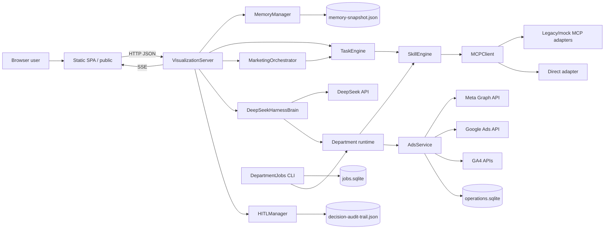
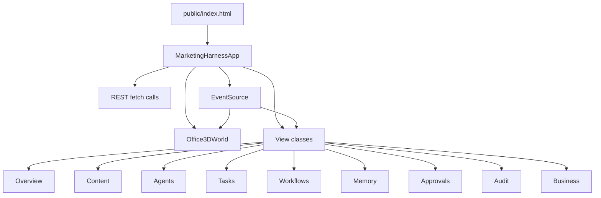
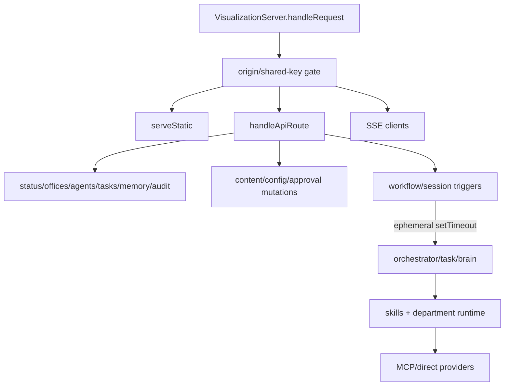
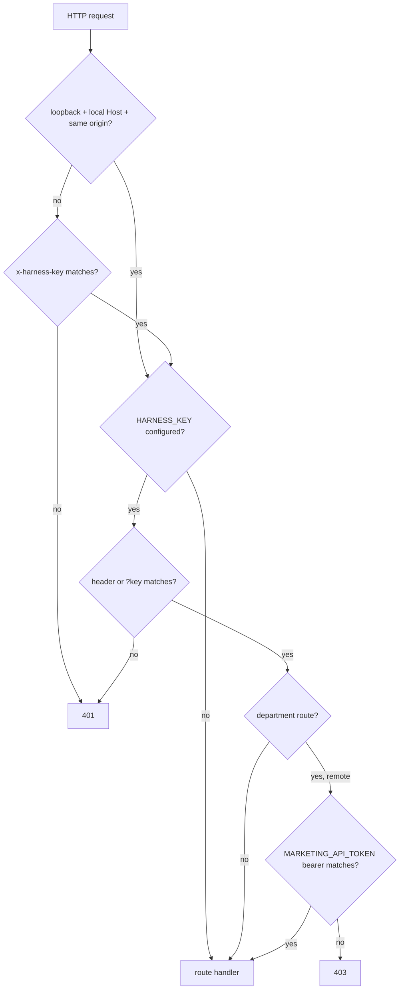
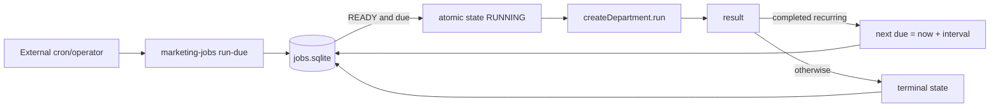
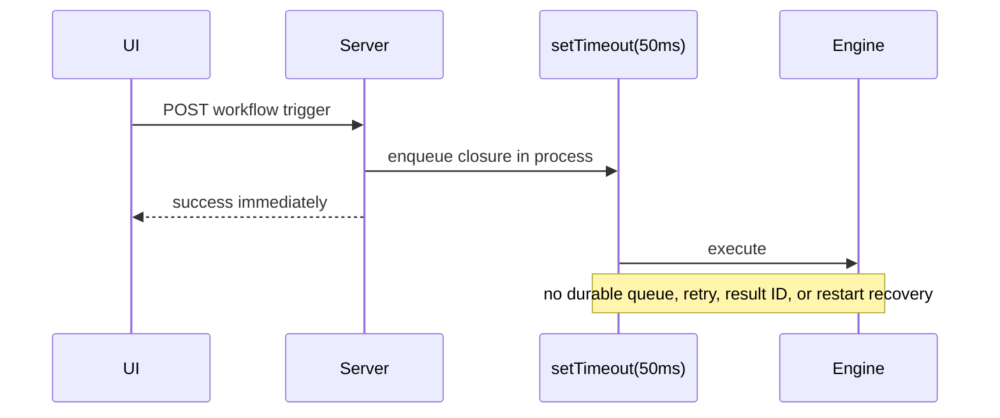
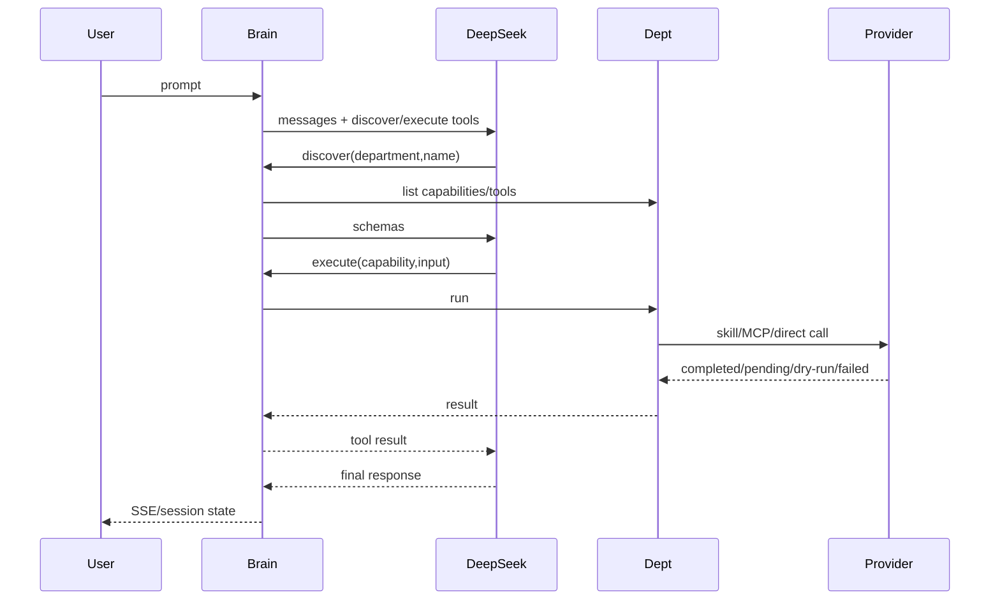
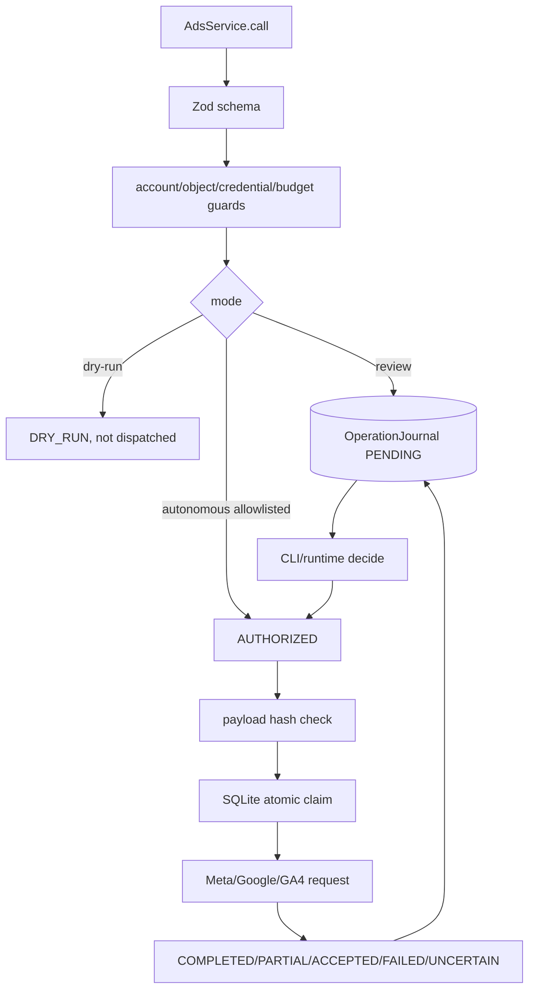
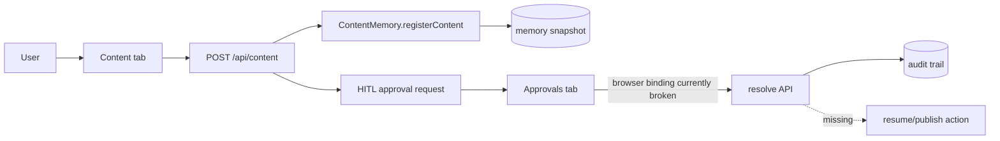
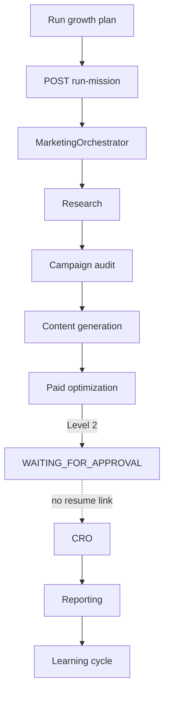

# Marketing Harness — Implementation Architecture & Technical Audit

Audited: 2026-09-24  

Historical snapshot: the TaskEngine, AgentRegistry, SkillEngine, and MetricsCollector described below were removed when execution was consolidated on `src/departments/runtime.ts`.
Commit inspected: `4bc8a83cf8744b3ccf9b33e922d591fd52ee7cf5`  
Scope: 184 authored files. Generated/runtime directories (`node_modules`, `dist`, `.pnpm-store`, `.marketing-data`, `.test-marketing-data`, `.ua`) were excluded from source inventory.  
Verification: `pnpm run build` passed; `pnpm test` passed all 51 tests in 9 files; 14 first-party browser scripts passed `node --check`; 17 representative read-only HTTP routes returned HTTP 200 from a live local server.

## Status and maturity model

| Mark | Meaning |
|---|---|
| ✅ | Implemented, connected, and verified in the audited environment |
| 🟡 | Partially connected or functional only under stated conditions |
| 🔴 | Implemented path contains a flow-breaking defect |
| ⚪ | Missing |
| 🔵 | Mocked, seeded, simulated, or hardcoded |
| ⚫ | Present but unused/unreachable in the running product |

The audit distinguishes four maturity levels:

1. **Code exists** — a source implementation is present.
2. **Connected** — a real caller reaches it.
3. **Functional** — the connected path was verified or has a complete executable flow.
4. **Production-ready** — durable, secured, observable, and live-provider verified.

Passing tests establishes only the behavior covered by those tests. It does not make simulated provider data live or close browser, security, durability, and operational gaps.

## 1. System structure

| Area | Implementation | Current state |
|---|---|---|
| Frontend | Static SPA in `public/index.html`, `public/js/app.js`, 10 loaded view classes, Three.js office | 🟡 Connected; several UI actions are broken or mocked |
| Backend | Native Node HTTP server in `src/server/server.ts`; no Express/Nest | ✅ Starts and serves static/UI/API/SSE |
| Database | SQLite via `node:sqlite` for jobs and ad-operation journal | 🟡 Durable for those two subsystems only |
| Application storage | JSON/YAML under `.marketing-data/` and `config/business.yaml` | 🟡 Local filesystem, mostly whole-file persistence |
| Services | Memory, task engine, orchestrator, learning, departments, ads service, visualization | 🟡 Mixed real orchestration and templates/simulation |
| Queue/workers | No queue. `setTimeout` background work plus explicit SQLite job runner | 🟡 Non-durable HTTP background work; job runner needs external scheduling |
| Cron | No in-process cron and no Docker/Railway scheduler definition | ⚪ Missing automatic schedule |
| AI/agents | DeepSeek tool-calling runner, 8 departments, 23 skills, 15 lazily loadable agent classes | 🟡 DeepSeek requires credentials; most `BaseAgent` classes are not in normal task execution |
| External integrations | DeepSeek, Meta Graph, Google Ads, GA4; mock CMS/CRM/email/GSC/research; draft-only LinkedIn | 🟡 Real adapters exist but are disabled/unverified; most legacy adapters are mocked |
| Authentication | Local/same-origin trust plus optional `HARNESS_KEY`; extra bearer token for remote department API | 🟡 Shared-secret only; no users, sessions, roles, or RBAC |
| Notifications | SSE event stream only | 🟡 In-process and non-durable |
| Webhooks | None | ⚪ Missing |

### Overall architecture



### Frontend architecture



### Backend architecture



## 2. Page and route inventory

There is one server-rendered route, `/`, with tab panels rather than client-side URL routes. Unknown non-API paths fall back to `index.html`. “Route” below therefore identifies the UI tab key.

| Page / tab | Purpose | Main components/functions | APIs | Data read/changed | Access | Status |
|---|---|---|---|---|---|---|
| Team Floor `/` → `3d` | 3D live office, command dispatch, simulation | `MarketingHarnessApp`, `Office3DWorld`, `AgentInspector`, `dispatchPrompt`, `connectEventStream`, `handleIncomingEvent` | `GET /api/offices`, `GET /api/agents`, `GET /api/events/stream`, `POST /api/sessions/create`, simulation start/stop | Static office map, live in-process agent state, DeepSeek sessions | Shared global access gate | 🟡 DeepSeek action needs env credentials; visualization agents are predefined, not registry instances |
| This Week `/` → `overview` | Business/strategy/performance summary and mission launch | `OverviewView.render`, `refreshStatus`, `triggerWorkflow` | `GET /api/status`, `POST /api/workflows/run-mission` | Memory snapshot + hardcoded capability counts | Same | 🟡 Display works; mission is async, non-durable, and default live mode can fail after returning success |
| Content `/` → `content` | Content library CRUD and approval staging | `ContentView.load/render/saveEditor/saveNewPiece/deletePiece/requestApproval` | content CRUD + request-approval | `ContentMemory` artifacts and brand checks | Same | 🟡 CRUD works; approval refresh calls nonexistent `loadApprovals()` |
| The Team `/` → `agents` | Search/filter agent cards and jump to 3D | `AgentsView.render/renderAgentCard`, `refreshAgents` | Initial `GET /api/agents`; later renders cache | `AgentStateAdapter` states seeded from `OfficeMapper` | Same | 🔵 Predefined visualization roster; not proof that agent classes are loaded/executing |
| Work Log `/` → `tasks` | Task state/trace display | `TasksView.render/setFilter/renderTaskItem`, `refreshTasks` | `GET /api/tasks` | In-memory `TaskEngine.tasks` | Same | 🟡 Functional per process; all tasks disappear on restart |
| Plans `/` → `workflows` | Show workflow cards and trigger flagship mission | `WorkflowsView.render/renderWorkflowCard`, `triggerWorkflow`, `tourWorkflowIn3D` | `GET /api/workflows`, `POST /api/workflows/run-mission` | Hardcoded workflow definitions; runtime mission | Same | 🟡 Definitions are hardcoded and include IDs not backed by `AgentRegistry` |
| What It Learned `/` → `memory` | Show business facts, strategy, personas, rules, failures | `MemoryLearningView.render`, `refreshMemory` | `GET /api/memory/summary` | 10 memory tiers + seeded graph count | Same | 🔵/🟡 Connected to persistence, but much initial data is seeded and graph count is hardcoded as 12 |
| Needs Your Yes `/` → `approvals` | Resolve pending human approvals | `ApprovalsView.render`, static `resolve` | `GET /api/approvals`, `POST /api/approvals/:id/resolve` | In-memory approval queue/history | Same | 🔴 `window.ApprovalsView` is an instance but buttons call static `resolve`; approvals also do not resume waiting tasks |
| Why I Did That `/` → `audit` | Decision records and evidence filtering | `AuditView.render`, static `setFilter` | `GET /api/audit?limit=60` | `decision-audit-trail.json` | Same | 🟡 Records render; filter expects undefined `window.AuditViewInstance` |
| My Business `/` → `business` | Edit validated business/brand/budget/autonomy config | `BusinessView.load/saveAll/mark/render*` | `GET/PATCH /api/business/config` | `config/business.yaml`, resynced memory | Same | ✅ Connected and schema validated |
| Departments hidden panel | Department telemetry cards | `DepartmentsView.render/renderDepartmentCard` | `GET /api/departments` | Office layout + state summary | No navigation element | ⚫ Constructed and loaded, but unreachable through UI navigation |
| Knowledge Graph view | Graph visualization copy | `KnowledgeGraphView.render` | Intended `GET /api/knowledge-graph` | Seeded graph | Not loaded | ⚫ File is neither included by `index.html` nor instantiated by `app.js` |

## 3. HTTP API inventory

All handlers live in `src/server/server.ts`. Unless noted, access is governed by the global local/same-origin or `HARNESS_KEY` gate.

| Method + endpoint | Handler → service/data | Frontend caller | Request → response | Auth | Status |
|---|---|---|---|---|---|
| `GET /api/events/stream` | `handleRequest` → event bus/state/brain | `connectEventStream` | SSE init + `event` messages | Global gate; query `key` supported | ✅ In-process only |
| `GET /api/departments/catalog` | `createDepartment().listCapabilities()` | None; tests/external | none → departments/capabilities | Global gate | ✅/⚫ |
| `GET /api/departments/:id/tools` | department runtime `listTools` | None | id → tool schemas | Global + remote `MARKETING_API_TOKEN` | 🟡 Non-ad departments return only already-loaded MCP tools |
| `POST /api/departments/:id/run` | department runtime `run` | None | `{capability,input,objective?,taskId?}` → run result | Global + remote bearer | ✅ Tested; provider-dependent |
| `GET /api/status` | memory + registry + task engine | Overview | none → business/strategy/performance/capability counts | Global | 🟡 Reports 0 registered agents until lazy loading |
| `GET /api/offices` | `OfficeMapper`, `AgentStateAdapter` | Team Floor | layout/status summary | Global | 🔵 Static roster |
| `GET /api/agents` | `AgentStateAdapter` | Team Floor/Team | visualization states | Global | 🔵 Static roster plus live events |
| `GET /api/agents/:id` | `getAgentState` | None | path id → state/404 | Global | ✅/⚫ |
| `GET /api/tasks` | `TaskEngine.getAllTasks` | Work Log | none → in-memory tasks | Global | 🟡 Non-durable |
| `GET /api/approvals` | `HITLManager.getPendingRequests` | Approvals | none → pending queue | Global | 🟡 Non-durable |
| `POST /api/approvals/:id/resolve` | `HITLManager.resolveApproval` | Approvals | action/feedback/edit → resolved request | Global | 🔴 Backend resolves record but does not transition/resume task or provider operation |
| `GET /api/audit` | `AuditTrail.getRecentDecisions` | Audit | `limit`, `question` → records | Global | ✅ |
| `GET /api/knowledge-graph` | `MarketingKnowledgeGraph.toJSON` | None | graph | Global | 🔵/⚫ Seeded graph, unused by UI |
| `GET /api/metrics` | `MetricsCollector.getSummary` | None | summary | Global | ⚫ No production caller invokes `track()` |
| `POST /api/workflows/run-mission` | delayed `runIncreaseQualifiedLeadsMission` | Overview/Plans | none → immediate accepted message | Global | 🟡 No operation ID/result; failure occurs after success response |
| `POST /api/workflows/run-daily` | delayed `runDailyLoop` | None | none → immediate message | Global | 🟡/⚫ Empty job DB makes this a no-op |
| `POST /api/workflows/trigger` | `TaskEngine.createTask/executeTask` | None | task fields → `taskId` | Global | 🟡 Ephemeral background execution |
| `GET /api/simulation/status` | `SimulationEngine.getStatus` | None | running flag | Global | ✅/⚫ Initial state arrives through SSE instead |
| `POST /api/simulation/start` | `SimulationEngine.start` | Header button | none → running | Global | ✅ Simulated |
| `POST /api/simulation/stop` | `SimulationEngine.stop` | Header button | none → stopped | Global | ✅ Simulated |
| `POST /api/sessions/create` | `DeepSeekHarnessBrain.createSession` | Command bar | prompt/options → session | Global | 🟡 Requires `DEEPSEEK_API_KEY` and model |
| `GET /api/sessions` | brain session map | None | active + all sessions | Global | 🟡/⚫ Persisted files are never reloaded |
| `GET /api/sessions/:id` | brain session map | None | id → session/404 | Global | 🟡/⚫ |
| `GET /api/workflows` | hardcoded literal list | Plans | none → 3 definitions | Global | 🔵 |
| `GET /api/departments` | offices + state summary | Hidden panel, initial load | departments/telemetry | Global | 🔵/⚫ |
| `GET /api/memory/summary` | memory tiers | Memory | facts/strategy/personas/rules/etc. | Global | 🟡 Seeded + persisted |
| `GET /api/content` | `ContentMemory.getAllArtifacts`, brand checks | Content | artifacts/totals | Global | ✅ |
| `GET /api/content/:id` | `ContentMemory.getArtifact` | None | id → artifact/404 | Global | ✅/⚫ |
| `POST /api/content` | register content, persist, optional HITL | Content | title/body + metadata → artifact | Global | ✅; approval queue is non-durable |
| `PUT/PATCH /api/content/:id` | update artifact, persist | Content | partial artifact → artifact | Global | ✅ |
| `DELETE /api/content/:id` | delete artifact, persist | Content | id → confirmation | Global | 🟡 Works same-origin; CORS allow-methods omits `DELETE` |
| `POST /api/content/:id/request-approval` | create HITL request | Content | id → approval | Global | 🔴 Backend works; caller throws after success due to missing `loadApprovals()` |
| `GET /api/business/config` | `ConfigLoader.loadConfig` | Business | config | Global | ✅ |
| `PUT/PATCH /api/business/config` | deep merge → Zod → YAML → memory resync | Business | config patch → reloaded config | Global | ✅ |
| `POST /api/business/phrases` | config phrase add/remove | None | kind/action/phrase → list | Global | ✅/⚫ Duplicate path; page saves full config instead |
| `GET /*` | `serveStatic`, SPA fallback | Browser | file/path → asset or `index.html` | Global gate | ✅ |

### HTTP mismatch summary

- **Called but missing:** no missing HTTP path was found.
- **Implemented but unused:** agent detail, knowledge graph, metrics, daily trigger, generic task trigger, sessions list/detail, business phrases, most department HTTP APIs.
- **Duplicate behavior:** phrase mutation duplicates business-config PATCH; department tool execution overlaps stdio MCP and DeepSeek execution.
- **Mock/hardcoded:** workflow catalogue, office/agent roster, knowledge graph seed, many memory seeds.

## 4. MCP/tool API inventory

### Modular stdio MCP

`bin/mcp.js` exposes each selected department over MCP stdio:

- `department_capabilities`
- `department_run` when not platform-scoped
- all tools returned by the selected department runtime

### Department skills (23)

Research: `skill_market_research`, `skill_competitor_analysis`  
Content/blog/email/social: `skill_keyword_research`, `skill_blog_generation`, `skill_email_generation`, `skill_social_generation`  
Ads/analytics: `skill_ad_analysis`, `skill_campaign_analysis`, `skill_campaign_optimization`, `skill_ga4_analysis`, `skill_performance_reporting`  
LinkedIn: `skill_linkedin_post_writer`, `skill_linkedin_humanizer`, `skill_linkedin_hook_extractor`, `skill_linkedin_comment_drafter`, `skill_linkedin_reply_handler`, `skill_linkedin_content_planner`, `skill_linkedin_profile_optimizer`, `skill_linkedin_repurposer`, `skill_linkedin_interviewer`, `skill_linkedin_engager_analytics`, `skill_linkedin_thread_monitor`, `skill_linkedin_employee_advocacy`.

### Typed direct provider tools (149)

Defined programmatically in `src/departments/ads/tools.ts` and routed by `AdsService`:

| Platform | Count | Complete families |
|---|---:|---|
| Meta | 69 | `ads_compare_performance`, `ads_analyze_creative`, `ads_launch_meta`; list/get/create/update/delete for campaigns, ad sets, ads, audiences, labels, catalogs, product sets/feeds; constrained creative/lead-form CRUD; leads/products/uploads/pixels/pages/users/Instagram reads; accounts, insights, uploads, audience users, conversions, test leads, page posts, targeting |
| Google Ads | 44 | GAQL search/accounts; `google_ads_mutate_*` for 30 resource families; keyword ideas/history/forecast; conversion uploads; customer match; experiment schedule/promote/end/graduate |
| GA4 | 36 | report/pivot/realtime/compatibility/metadata; Admin list/CRUD for audiences, channel groups, streams, key events, annotations; link reads; attribution, retention, enhanced-measurement settings |

Every write is schema validated, account/object allowlisted, operation-ID journaled, and claimed in SQLite. Current `config/ads-module.yaml` is `dry-run` with empty allowlists, so live mutation is not enabled.

### Legacy/mock MCP adapters (22)

| Adapter | Tools | Reality |
|---|---|---|
| Google Ads | `google_ads_get_campaign_performance`, `google_ads_apply_negative_keywords`, `google_ads_update_budget_and_bids` | 🔵 Hardcoded in simulation; direct aliases exist when enabled |
| Meta | `meta_ads_get_performance_and_fatigue`, `meta_ads_create_creative_variation`, `meta_ads_pause_fatigued_ad` | 🔵 Hardcoded in simulation; direct aliases exist when enabled |
| GA4 | `ga4_get_funnel_metrics`, `ga4_get_channel_attribution` | 🔵 Hardcoded in simulation; direct aliases exist when enabled |
| Research | `research_competitor_ad_library`, `research_serp_intent_cluster` | 🔵 Hardcoded; no live connector |
| GSC | `gsc_query_search_performance` | 🔵 Hardcoded; no live connector |
| CMS | `cms_create_and_stage_article` | 🔵 Fabricated ID/preview URL; no CMS call |
| CRM | `crm_get_pipeline_stage_metrics`, `crm_update_lead_score_rules` | 🔵 Hardcoded/no external write |
| Email | `email_send_lifecycle_campaign`, `email_get_engagement_metrics` | 🔵 Returns simulated active automation/metrics |
| LinkedIn | 6 draft/stage tools | ✅ Draft-only by design; no LinkedIn authentication or publishing |

## 5. Important component/function mappings

```text
Command bar
→ MarketingHarnessApp.dispatchPrompt
→ POST /api/sessions/create
→ DeepSeekHarnessBrain.createSession / execute
→ runDeepSeek
→ DeepSeek chat-completions API
→ discover/execute department tools
→ createDepartment.run
→ Skill or AdsService/MCPClient
→ local memory or external provider
```

```text
Content page
→ ContentView.saveNewPiece/saveEditor/deletePiece
→ /api/content routes
→ ContentMemory.registerContent/updateArtifact/deleteArtifact
→ MemoryManager.persistAllToDisk
→ .marketing-data/memory-snapshot.json
```

```text
Business page
→ BusinessView.saveAll
→ PATCH /api/business/config
→ VisualizationServer.deepMerge
→ BusinessConfigSchema.parse
→ ConfigLoader.saveConfig
→ config/business.yaml
→ MemoryManager.resyncConfigFacts + persistAllToDisk
```

```text
Plans/Overview
→ MarketingHarnessApp.triggerWorkflow('run-mission')
→ POST /api/workflows/run-mission
→ runIncreaseQualifiedLeadsMission
→ MarketingOrchestrator.runMission
→ TaskEngine.executeTask
→ SkillEngine.executeSkill
→ MCPClient.callTool
→ provider adapter
```

```text
Approvals page
→ ApprovalsView.resolve [BROKEN browser binding]
→ POST /api/approvals/:id/resolve
→ HITLManager.resolveApproval
→ audit + event bus
→ [MISSING: task transition/resume or provider operation decision]
```

### Unused, duplicate, or orphaned code

- `public/js/views/knowledge-graph-view.js`: unused and not loaded.
- Departments panel: loaded but no navigation entry.
- `src/mcp/auth/oauth-loopback.ts`: exported/tested but no CLI/API flow invokes it.
- `MetricsCollector.track`: no production callers; `/api/metrics` normally stays empty.
- `WriteGate`: tested/exported but current direct adapter uses `AdsService`/`OperationJournal` instead.
- `skill_keyword_research` is defined twice; the catalogue loads `src/skills/marketing/keyword-research.skill.ts`, leaving the definition in `blog-generation.skill.ts` orphaned.
- Fifteen `BaseAgent` subclasses are lazy-loadable, but normal `TaskEngine` execution runs skills directly. Only `generate-report` explicitly loads an agent class.
- `MarketingOrchestrator.agentRegistry` is constructed but not used to execute mission tasks.
- Two ad stacks coexist: `mcp/direct + ads-config + WriteGate` and `departments/ads + ads-module + OperationJournal`.

## 6. Data and database mapping

### Durable stores

| Store | Schema/important fields | Used by |
|---|---|---|
| `.marketing-data/memory-snapshot.json` | business facts; customer personas/insights; brand rules; content artifacts; campaigns; KPI snapshots; strategies; feedback; experiments; failures; graph; `savedAt` | MemoryManager, most dashboard read APIs, skills, learning |
| `.marketing-data/decision-audit-trail.json` | `id,timestamp,taskId,missionId,agent,question,summary,evidence,inputs,actionsTaken,expectedImpact,actualImpact,confidenceScore` | AuditTrail, `/api/audit` |
| `.marketing-data/sessions/:uuid.json` | DeepSeek session, stages, progress, summaries | Brain writes; no startup reload |
| `.marketing-data/oauth/:provider.json` | access token, refresh token, expiry, updatedAt | TokenStore/direct provider clients |
| `config/business.yaml` | validated business profile, products, brand, budget, goals, automation | ConfigLoader/business page/memory resync |
| `.marketing-data/jobs/jobs.sqlite` | table `jobs(id PK, due, state, payload, result)` | DepartmentJobs CLI and daily/weekly/monthly loops |
| `.marketing-data/ads/operations.sqlite` | table `operations(id PK, hash, record)`; record contains tool/args/status/result/error | AdsService idempotency/approval journal |

There is no ORM, server database, migration framework, foreign-key relationship, or multi-tenant partition.

### Logical model relationships

```mermaid
erDiagram
  BUSINESS ||--o{ PRODUCT : offers
  PRODUCT }o--o{ PERSONA : targets
  PERSONA ||--o{ CUSTOMER_INSIGHT : has
  CONTENT_ARTIFACT }o--|| PERSONA : targets
  CONTENT_ARTIFACT }o--o{ CAMPAIGN : deployed_in
  CAMPAIGN ||--o{ KPI_SNAPSHOT : measured_by
  EXPERIMENT ||--o{ EXPERIMENT_VARIANT : contains
  STRATEGY ||--o{ CAMPAIGN : directs
  FEEDBACK_RULE }o--|| BRAND_PROFILE : updates
  KNOWLEDGE_NODE ||--o{ KNOWLEDGE_EDGE : from
  KNOWLEDGE_NODE ||--o{ KNOWLEDGE_EDGE : to
  JOB ||--o| DEPARTMENT_RUN : executes
  OPERATION ||--o| PROVIDER_CALL : dispatches
```

These relationships are conceptual; JSON IDs and arrays are not database-enforced.

### Page → API → service → model → store

```text
Content → /api/content → ContentMemory → ContentArtifact → memory-snapshot.json
Business → /api/business/config → ConfigLoader → BusinessConfigSchema → business.yaml + memory snapshot
Memory → /api/memory/summary → MemoryManager tiers → tier records → memory-snapshot.json
Audit → /api/audit → AuditTrail → DecisionRecord → decision-audit-trail.json
Approvals → /api/approvals → HITLManager → HumanApprovalRequest → in memory only
Tasks → /api/tasks → TaskEngine → TaskContext → in memory only
Sessions → /api/sessions → DeepSeekHarnessBrain → DeepSeekHarnessSession → map + write-only JSON files
```

## 7. Authentication and permissions



There is no login, cookie/session, user identity, role, permission matrix, ownership, or per-business tenancy. Every authenticated caller can read and mutate all exposed data.

Authorization/security gaps:

- `HARNESS_KEY` may be placed in the URL query, exposing it to browser history and infrastructure logs.
- Frontend patches `fetch` with the shared key only **after** initial API calls; key-protected deployments initially fail to load data.
- OAuth tokens are stored as plaintext JSON, with no encryption/keyring integration.
- Request bodies are buffered with no size limit; only the later DeepSeek prompt validation caps prompt length.
- `DELETE` is missing from `Access-Control-Allow-Methods` despite a DELETE endpoint.
- No rate limiting, CSRF token, security headers/CSP, audit identity, or role-based protection exists.
- Docker/Railway bind to `0.0.0.0`; remote access is intentionally blocked unless `HARNESS_KEY` is configured.

## 8. Background, external, and AI flows

### Background job flow



No external cron definition is included. The current job database was empty during audit.

### HTTP “background” flow



### DeepSeek agent flow



### Direct ad write flow



The dashboard HITL queue and `OperationJournal` approval are separate systems; resolving one does not resolve the other.

### External systems

| System | Implementation | Current status |
|---|---|---|
| DeepSeek | `https://api.deepseek.com/chat/completions` | 🟡 Real, credential-gated, no live acceptance test performed |
| Meta Graph | `AdsTransport` and legacy direct clients | 🟡 Real code, disabled by config, duplicated stacks |
| Google Ads | v25 REST + OAuth refresh | 🟡 Real code, disabled, version override supported, not live-verified |
| GA4 | Data/Admin APIs | 🟡 Real code, disabled, not live-verified |
| Google OAuth | refresh flow + loopback helper | 🟡 Refresh works in code; no complete operator login command |
| CMS/CRM/email/GSC/research | local handlers | 🔵 Hardcoded simulation, no external request |
| LinkedIn | local draft/stage handlers | ✅ Draft-only; ⚪ publishing intentionally absent |
| Google Fonts | browser stylesheet | ✅ External UI dependency |

## 9. Major business workflows

### Content creation and approval



### Flagship mission



The tested simulation correctly stops at approval. The end-to-end “approve and continue” half is missing.

## 10. Feature tracking

| Feature | Page | API | Backend | Database/store | Status | Missing work |
|---|---|---|---|---|---|---|
| Dashboard shell/3D | Team Floor | offices/agents/SSE | visualization services | memory only | 🟡 | production telemetry truth, reconnect/backpressure tests |
| DeepSeek command | Team Floor | sessions/create | brain + runner + departments | session JSON write only | 🟡 | startup reload, durable execution, configured model acceptance |
| Business summary | This Week | status | memory/registry/tasks | snapshot + memory | 🟡 | correct lazy agent/tool counts |
| Content CRUD | Content | content CRUD | content + brand memory | snapshot | ✅ | atomic persistence/backups for production |
| Content approval | Content/Approvals | request/resolve | HITL | memory only | 🔴 | fix browser calls, persist, connect resolution to action |
| Agent directory | Team | agents | state adapter/office mapper | memory only | 🔵 | reconcile real registry/runtime identities |
| Task log | Work Log | tasks | task engine | memory only | 🟡 | persistence/recovery/pagination |
| Workflow catalogue | Plans | workflows | hardcoded server list | none | 🔵 | derive from executable workflow definitions |
| Mission execution | Plans/Overview | run-mission | orchestrator/task/skills | mixed | 🔴 | approval resume, durable job, truthful accepted/completed status |
| Memory/learning | Memory | memory/summary | 10 tiers + learning | snapshot | 🟡 | remove seed-as-live ambiguity; dynamic graph count |
| Decision audit | Audit | audit | AuditTrail | JSON | 🟡 | fix filter, actor identity, atomic/append persistence |
| Business settings | Business | business/config | ConfigLoader + Zod | YAML + snapshot | ✅ | concurrency/version control for multi-user use |
| Department runtime | Hidden/external | department APIs/MCP | createDepartment | per-dept snapshot | ✅/🟡 | expose intentionally or remove hidden UI; live provider setup |
| Scheduled jobs | None/CLI | run-daily or jobs CLI | DepartmentJobs | SQLite | 🟡 | actual scheduler, monitoring, retry/dead-letter behavior |
| Direct ads | None/CLI/MCP | 149 tools | AdsService/transport | operations SQLite | 🟡 | consolidate stacks, configure allowlists, live acceptance tests |
| Authentication | All | global middleware | shared-key checks | env only | 🟡 | users/RBAC/session/secret handling |
| Metrics | None | metrics | MetricsCollector | memory only | ⚫ | instrument callers and durable exporter |
| Knowledge graph UI | Unloaded | knowledge-graph | seeded graph | snapshot | ⚫ | load/route view and use dynamic graph data |

## 11. Current state

### ✅ Completed

- Project builds cleanly and all 51 automated tests pass.
- Native HTTP server, static SPA serving, representative GET APIs, SSE setup, content CRUD, validated business config, audit persistence, department runtime, MCP stdio, SQLite job claiming, and ad operation journaling exist.
- Content drafting, memory/learning primitives, simulation mode, LinkedIn draft-only skills, and typed provider schemas are implemented.

### 🟡 Partial

- DeepSeek sessions, tasks, approvals, metrics, agent states, workflow triggers, scheduling, and live providers.
- Persistent memory is local whole-file JSON, not transactional or multi-user.
- Real provider adapters exist but are disabled and not live-acceptance verified.

### 🔴 Broken

- Approval buttons call a static method through an instance.
- Content approval success then calls nonexistent `MarketingHarnessApp.loadApprovals()`.
- Approval resolution does not resume a waiting TaskEngine task or AdsService operation.
- Mission endpoint reports success before the mission can fail and provides no durable operation identifier.
- Key-protected frontend performs initial fetches before attaching the shared-secret header.
- Audit filter has no `AuditViewInstance` assignment.

### ⚪ Missing

- User login, identity, RBAC, tenancy, durable execution queue, automatic cron deployment, webhook intake, external notifications, retry/dead-letter operations, complete OAuth operator flow, provider acceptance evidence, and approve-to-resume workflow.

### ⚫ Unused

- Knowledge Graph view, visible Departments navigation, metrics API in normal operation, OAuth loopback in a user flow, WriteGate in current direct execution, duplicate keyword skill definition, and several read/detail endpoints.

## WHERE WE ARE NOW

The product is a working local-first marketing orchestration prototype with a polished SPA, deterministic skills, persistent local memory, simulated provider adapters, a real DeepSeek tool runner, and a substantial typed direct-ad API layer. Its strongest verified paths are build/test health, local dashboard reads, content CRUD, business configuration, memory primitives, department execution, simulation, and safety validation around direct ad operations.

It is not yet production-ready as an autonomous marketing operating system. The UI overstates some runtime facts, several critical approval interactions break, approval does not continue execution, workflow work is not durable, scheduling is manual, provider stacks are duplicated, and most non-ad integrations return hardcoded data.

### Recommended implementation order

1. Fix the approval browser bindings and implement a single persisted approve/reject/resume contract spanning TaskEngine and `OperationJournal`.
2. Replace `setTimeout` workflow execution with the existing SQLite job mechanism (or one durable queue) and return an operation ID/status endpoint.
3. Consolidate the two ad-integration/config/approval stacks into `AdsService` + one policy source.
4. Make UI truth derive from executable registries: agents, workflows, tools, graph node count, and provider mode.
5. Add identity/RBAC, remove query-string secrets, cap request bodies, encrypt/store OAuth tokens appropriately, and add security headers/rate limits.
6. Add an actual scheduler and live acceptance tests for each enabled provider before calling any external flow production-ready.

